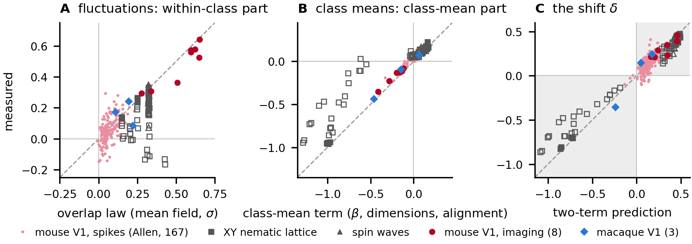

# Structure is in the zoom: the paper's numbers

The paper's results as `rung` and the scripts in this repository reproduce them. The tool itself, its install and its reading
rules are in the [README](README.md).

## What the paper shows

- **There is no probe-free exponent.** The GT3 recording's three exponents split exactly into floor and shift: random stimuli
  0.253 (floor 0.232, shift +0.020), neighbouring neurons 0.346 (floor 0.342), direction 0.305 (floor 0.065, shift +0.240).
  Random stimulus subsets stay at their floors in all 18 recordings (mean shift -0.002).
- **Direction lifts every grating recording**, from 0.20 (low contrast) to 0.45 (localized), above all 200 label permutations;
  classes added in random orders give shifts of the same size, so the grouping carries it. The shift reads the orientation and
  direction sectors of the tuning and is larger in the most direction-selective neurons.
- **What carries it.** Direction-dependent fluctuations around the class means lift the exponent, while in these recordings the
  class means pull it down. Two measured terms account for it with nothing fitted: one from how much the classes'
  fluctuations overlap, one from how the class means sit against them. In these recordings they track the shift's size, and the
  systems below test its sign, where it changes.
- **Two more laboratories.** In Allen Neuropixels spike counts the shift is positive in 32 of 32 mice in primary visual cortex and
  in 158 of 167 populations across visual areas. With temporal-frequency tuning removed, as for the split and the two terms, it is
  negative in 16 of the 167; the two terms evaluated at each population's sample counts give the sign of 14 of those 16 and of 163
  of 167 in all; their mean-field form gives 2 of the 16 (152 of 167). Allen's largest fluctuations are shared, untuned modes that partly
  track running and pupil; the class-mean term reverses there. The same terms give the sign in macaque V1 and in lattices of known
  structure.
- **What the shift adds.** Linear decoders read the class means. With the means projected out they fall to chance while the shift
  survives, and a quadratic decoder given each class's covariance still reads direction (accuracy 0.21 to 0.69; chance 0.125).
  Other covariance statistics inherit floors too: a median 69% of the principal-angle dissimilarity across the 167 Allen
  populations is label-blind floor, which the random-matrix model predicts within a median 2% of the
  permutation floors in imaging and 6% in Allen spike counts.



Every number above is read from its artifact by `tests/test_readme_numbers.py`.

## rung against the paper

Run as a user would, on arrays built from the public releases, rung returns the paper's numbers. With the floor the paper's
generators drew (`--paper-floor`: ten draws, seed 42, drawn rung by rung; the lattices' own seeds) it replays the printed shifts and
within-class parts exactly. With its default floor (20 draws) a shift differs from the printed one by the two runs' floor draws,
whose size the spread column shows.

| Dataset | rung, default floor | its spread over 20 seeds | rung, the paper's floor | paper | largest residual |
|---|---|---|---|---|---|
| GT3 direction ladder (Table 9) | +0.231 | +0.234 ± 0.004 | +0.233 | +0.233 | 3e-7 (float32) |
| Allen VISp, one mouse (715093703) | +0.188 | +0.204 ± 0.010 | +0.215 | +0.215 | 2e-15 |
| Allen VISp, TF-residualized arm | +0.226 | +0.239 ± 0.009 | +0.258 | +0.258 | 9e-16 |
| macaque V1, array 1 | +0.153 | +0.153 ± 0.004 | +0.146 | +0.146 | 7e-16 |
| macaque V1, array 2 | -0.353 | -0.355 ± 0.004 | -0.354 | -0.354 | 1e-15 |
| macaque V1, array 3 | +0.249 | +0.248 ± 0.002 | +0.245 | +0.245 | 8e-16 |
| XY nematic lattice, L 16, T 1.0 | -0.537 | -0.538 ± 0.002 | -0.542 | -0.542 | 4e-16 |
| XY lattice, polar side, T 0.7 | +0.445 | +0.438 ± 0.005 | +0.442 | +0.442 | 4e-16 |
| spin waves | +0.449 | +0.448 ± 0.001 | +0.449 | +0.449 | 7e-8 (float32) |

Residuals are the largest of the shift's and the within-class part's; "float32" marks a generator that worked in float32, where
rung computes in float64. Beyond the table: the worked examples of Appendix M return its printed values (GT3 and Pythia-160m,
every row); the candidate screen replays Appendix H's Allen screen exactly (each half's z, p and shift); the feature ladder
replays Appendix D's GT3 row; the blocks replay Appendix G's table to float32 rounding; `--account` on the eight grating
recordings tracks the shift's size with r = 0.88 (Figure 3; all eight shifts are positive, so imaging does not test the sign), and the identity at the rungs' sample counts tracks the
held-out within-class part with a mean error of -0.004; `rung llm --heads --paper-seeds` replays Appendix I's ranking of GPT-2's
circuit heads (AUC 0.92), and over ten default seeds (rung 1.14, every class order) the AUC is 0.930 ± 0.005. Generators: `rung_acceptance_replay.py`,
`rung_account_imaging.py`, `rung_heads_ioi.py`.

## Runs on data the paper never saw

`rung` was installed from this repository and run on a recording and on model families the paper never used.

**Allen Brain Observatory two-photon imaging** (Visual Coding; 61 primary visual cortex experiments in three excitatory lines;
drifting gratings, eight directions, about 75 presentations each, 86 to 474 cells). The release is NWB 1, read with h5py
(`heldout_allen2p_extract.py` reproduces the release's own per-presentation response); temporal frequency serves as strata.

```bash
rung data X.npy direction.npy --antipode pairs.json --sectors --decompose --cov-floors \
          --strata tf.npy --time-blocks 48
```

- Direction leaves its floor. The order-averaged shift is positive in 48 of 61 experiments and above its label permutations in 49
  (median +0.07), and it stays above the time-blocked null in 47 of those 49.
- The fluctuations lift and the class means pull down, as in the paper's imaging. The within-class part is positive in 47 of 61
  (median +0.21) and the class-mean part is negative in 53 (median -0.07). The class means lie along the strong fluctuations
  (median alignment a = 1.38), and a orders the class-mean part across experiments (Spearman -0.82). One fluctuation shape for every
  class turns the order-averaged shift negative in 56 of 61; equal class means leave it positive in 57.
- The class means are orientation-led in 60 of 61, and a median 68% of the principal-angle dissimilarity is label-blind floor.
- The response definition is part of the probe. The release divides each presentation by its own one-second baseline; without that
  division a falls in 55 of 61 experiments (median 1.01) and the class-mean part turns positive in 25. The sign follows a in both.
- At this design, read the order-averaged shift. With 75 presentations per class and a few hundred cells the classes differ in their
  own fluctuation dimension, and the shift along the declared angular order spans -0.62 to +0.72. Its SD over random orders (median
  0.19) follows that difference (Spearman 0.98 with the spread of single-class log PR) and falls to 0.05 when every class has one
  fluctuation shape. In the Allen Neuropixels populations the same SD is 0.05 (`allen_order_spread.json`).

**Qwen2.5-0.5B** on `axes/world_knowledge32.json` (`rung llm --match-last-token`): the order-averaged shift is positive at all 25
layers, from +0.014 at the embedding to +0.112 at the last layer, and the final-token-matched shift stays positive at every layer of
the second half. **OLMo-2-1B at three training checkpoints** (`--revision`): the second-half matched shift is -0.013 untrained,
+0.032 after 21B tokens and +0.047 at the final checkpoint, where the order-averaged shift is certified at all 17 layers.

**A new axis from a benchmark** (`axes/mmlu_subjects8_answer.json`, built with `rung axis` from `cais/mmlu`, eight subjects of 32
questions). MMLU subjects end on few distinct tokens ('?', ':', '_____.'), and `rung llm` warns that the final token can carry the
shift. Ending every prompt on the standard suffix `\nAnswer:` removes that: the subject shift then stays above its permutations at 22
of the 24 layers past the embedding, at about half its size with the varied endings (mean over those layers +0.094 against +0.193).
Give prompts a common ending whenever the classes differ in format.

## Further analyses in this repository

The repository also carries analyses beyond the camera-ready: the language-model battery at four Pythia sizes and five
architectures, the moral-concept axis before and after instruction tuning, the BLiMP and Baroni minimal pairs read against their
swap nulls, the equivariant network whose invariant layers read zero, and the calibrated population models. Their scripts and
artifacts are listed in the second table below.

## The extended version

The extended version of the paper (arXiv 2611.08506, version 3) adds the cyclic starts of every grating recording, the
language-model split averaged over class orders and net of its bias, the pooled-fluctuation control on Pythia-2.8B, the floor for
non-Gaussian samples, the macaque arrays at their own sample counts and a planted comparison with label CKA, RSA and manifold
capacity. Their generators and artifacts are in [v3/](v3/README.md), one row per script with the section it backs.

## Raw data

Raw neural data are public and not included. The grating and static recordings are the Figshare release 8279387 of Stringer et
al. (2021, Cell); the spontaneous sessions the release of Stringer et al. (2019, Science); the Allen Brain Observatory Neuropixels
visual-coding sessions; the CRCNS pvc-11 macaque arrays (Kohn and Smith 2016, doi:10.6080/K0NC5Z4X). The scripts read `raw/`:
each grating or static session as `raw/<session>.npy` (a dict with `sresp`, neurons by presentations, `istim`, the stimulus
angle, and `stat`, cell positions), spontaneous sessions under `raw/spont/`, the pvc-11 arrays under
`raw/pvc11/spikes_gratings/`, and the per-session Allen spike counts and running speeds under `raw/allen_counts/` and
`raw/allen_running/` (written from the NWB files by `allen_counts_local.py`, or on a cloud runner by `allen_counts_modal.py` and
`allen_running_modal.py`). Language-model hidden states go to `raw/llm_states/` (`llm_battery.py encode`, `llm_encode.py`;
several GB). Each docstring names the files it reads.

## Allen invalid intervals

Every Allen number excludes what the release itself marks invalid: presentations that overlap an `invalid_times` interval tagged
with the population's probe (the probe sent no data), `all_probes` or `stimulus`; units on electrodes with `valid_data` False; and
presentations in which a population whose valid-time rate predicts 10 or more spikes fires none (one population, session
743475441 VISp, is silent before 2135 s without a flag). `allen_fetch_nwb.sh` fetches the 32 session NWBs into `raw/allen_nwb/`;
`allen_invalid_map.py` writes the per-population masks to `data_canonical/allen_masks/` (shipped). `allen_engine.pop_view` takes
every Allen generator's presentations and units through the masks; `ALLEN_VARIANT=none` reproduces the unmasked values, `A` uses
the release's flags alone, `B` (the default) is the paper. The `allen_*_local.py` scripts run the cloud-run Allen generators on the
local counts through the same path; unmasked, they reproduce the cloud outputs to 5e-7. `rung --invalid-intervals` applies the same
exclusion to any recording.

The Allen two-term predictions in `allen_twoterm_predictions.json` were written by `allen_twoterm_predict.py` and committed before
the measured Allen results were compared with them; the two-term figure (`make_fig_twoterm.py`) shows both.

## Claim, artifact, script: the paper

| Claim | Artifact | Script |
|---|---|---|
| Random-stimulus ladders sit at their floors in 18 recordings; the floor follows the sampling crossover | stringer_theta_decomposition.json, withinclass_shuffle_identification.json, floor_crossover.json | random_zoom_all_recordings.py, withinclass_shuffle_identification.py, floor_crossover.py |
| Direction lifts every grating recording, above all 200 label permutations | run38_v1_label_permutations.json, orientation_zoom.json | run38_v1_label_permutations.py, shuffle_label_control.py |
| The order of the classes moves the shift little; the order effect over sixteen origins and its two parts | cr_order_effect_origins.json, fluctuation_overlap_profile.json | cr_order_effect_origins.py, fluctuation_overlap_profile.py, cr_appE_class_means.py |
| Neighbouring neurons stay near their floor | neuron_zoom_spatial.json | spatial_neuron_ladder.py, exchangeable_neuron_zoom.py |
| The two symmetry sectors; the most direction-selective third shifts more, also cross-fitted | multipole_harmonics_8dir.json, run59_shift_by_direction_selectivity.json, cr_ds_thirds_crossfit.json | multipole_harmonics_8dir.py, run59_shift_by_direction_selectivity.py, cr_ds_thirds_crossfit.py, make_fig_multipole.py |
| The exact split of the shift into a within-class and a class-mean part | run72_paper_designs_split.json | run72_paper_designs_split.py |
| What carries the shift: within-class shuffle, pooled fluctuations, tuning inside each bin removed | cr_withinclass_controls.json, cr_order_and_withinbin_controls.json, withinclass_shuffle_identification.json | cr_withinclass_controls.py, cr_order_and_withinbin_controls.py, withinclass_shuffle_identification.py |
| The overlap law and the class-mean term; the sign law and the alignment a | overlap_identity_checks.json, overlap_identity_followup.json, classmean_sign_condition.json, classmean_fluctuation_alignment.json, signal_noise_alignment.json | overlap_identity_checks.py, overlap_identity_followup.py, classmean_sign_condition.py, classmean_fluctuation_alignment.py, signal_noise_alignment.py, make_fig_overlap_laws.py |
| The two terms against the shift: imaging, Allen, macaque, lattices | twoterm_imaging.json, allen_twoterm_predictions.json, allen_sessions/session_\*.json, macaque_pvc11_twoterm.json, xy_twoterm.json, xy_polar_twoterm.json, fig_twoterm_marker.json | make_fig_twoterm.py, twoterm_imaging.py, allen_twoterm_predict.py, allen_run.py, macaque_pvc11_twoterm.py, xy_twoterm.py, xy_polar_twoterm.py, fig_twoterm_marker.py |
| Beyond mean field: the overlap identity at the rungs' sample counts (imaging, lattices, the sampling rule) | finite_n_imaging.json, finite_n_lattice.json, finite_n_rule.json | finite_n_identity.py, finite_n_imaging.py, finite_n_lattice_regen.py, finite_n_rule.py |
| Allen with temporal frequency separated: per-session shifts, splits, controls, verdicts and misses | allen_sessions/session_\*.json, allen_verdicts.json, allen_twoterm_misses.json, allen_miss_threshold.json | allen_run.py, allen_engine.py, allen_score.py, allen_twoterm_misses.py, allen_miss_threshold.py |
| Allen's state modes held out, running, pupil and lagged state | allen_heldout_modes.json, allen_heldout_modes_mechanism.json, allen_heldout_modes_control.json, allen_modes_removed.json, allen_modes_running.json, allen_modes_pupil.json, allen_modes_state_basis.json | allen_heldout_modes.py, allen_heldout_modes_mechanism.py, allen_heldout_modes_control.py, allen_modes_removed.py, allen_modes_running.py, allen_modes_pupil.py, allen_modes_state_basis.py |
| Choosing an axis among candidates on half the Allen mice | allen_axis_screen.json, allen_axis_screen_rescore.json, allen_axes_halves.json | allen_axis_screen.py, allen_axis_screen_rescore.py, allen_axes_halves.py |
| The Allen invalid-interval masks | allen_masks/, allen_invalid_map.json | allen_invalid_map.py, allen_fetch_nwb.sh, allen_engine.py |
| Macaque V1, three Utah arrays | macaque_pvc11.json, macaque_pvc11_twoterm.json | macaque_pvc11.py, macaque_pvc11_twoterm.py |
| What the shift adds: decoders, the means projected out, decoding against the means' strength | meanfree_shift_exact.json, meanfree_shift.json, meanfree_crossfit.json, decoding_vs_beta.json, v1_decoders.json | meanfree_shift_exact.py, meanfree_shift.py, meanfree_crossfit.py, decoding_vs_beta.py, v1_decoders.py |
| The within arm under the calibrated null (Freedman-Lane, rung 1.13), and the arms' nulls calibrated on synthetic populations | meanfree_freedman_lane.json, null_calibration.json | meanfree_freedman_lane.py, null_calibration.py |
| Floors under other covariance statistics, and the floor law | allen_covariance_floors_decoders.json, covariance_floors_trial_ladder.json, principal_angle_floor_imaging.json, principal_angle_floor_allen.json | allen_covariance_floors_decoders.py, covariance_floors_trial_ladder.py, principal_angle_floor_law.py, principal_angle_floor_imaging.py, principal_angle_floor_allen.py |
| Lattices and constructed systems of known structure | lattice_ground_truth_score.json, xy_groundtruth.json, xy_onset.json, ising_spectral_account.json | lattice_ground_truth.py, lattice_ground_truth_score.py, xy_groundtruth.py, xy_onset.py, xy_split.py, ising_spectral_account.py |
| Language models: the topic and construction lifts at four Pythia sizes, last-token controls, probes, sparse autoencoders, a known circuit, other architectures | llm_battery_\*.json, llm_lasttoken_\*.json, llm_lasttoken_fractions.json, llm_probes_\*.json, llm_sae.json, llm_ioi.json, llm_architectures_\*.json, llm_path_nulls.json | llm_battery.py, llm_lasttoken.py, llm_lasttoken_fractions.py, llm_probes.py, llm_sae.py, llm_ioi.py, llm_architectures.py, llm_path_nulls.py, llm_score.py |
| Worked examples (`rung` on GT3 and on Pythia-160m) | worked_example_gt3.json, appm_lm_check.json | worked_example_lm_check.py |
| Runs on data the paper never saw: Allen two-photon (release response and no per-presentation baseline), Section 5's controls, Qwen2.5-0.5B, OLMo-2-1B checkpoints, MMLU subjects | heldout_allen2p/, heldout_allen2p_nobaseline/, heldout_allen2p_controls.json, heldout_allen2p_summary.json, heldout_allen2p_experiments.json, heldout_qwen05_\*.json, heldout_olmo2_1b_\*.json | heldout_allen2p_extract.py, heldout_allen2p_controls.py, heldout_allen2p_score.py |
| Allen Neuropixels: the declared-order shift against the order-averaged one and its SD over orders | allen_order_spread.json | allen_order_spread.py |
| Allen's two-term misses against the finite-sample identity: the within-class part of all 167 populations, the shift's sign in 163 | allen_finite_n_identity.json | allen_finite_n_identity.py |
| The equivariant network: the accumulation order its fluctuation overlaps name, and the part that carries it (Appendix J) | net_order_split.json, run41_cnn_ordering_perseed.json | net_order_split.py, run41_cnn_ordering_perseed.py |
| rung against the paper: replays of the paper's floors, the account on eight recordings, the attention heads | rung_acceptance_replay.json, rung_account_imaging.json, rung_heads_ioi.json | rung_acceptance_replay.py, rung_account_imaging.py, rung_heads_ioi.py, make_axis_ioi.py |
| Appendix checks: coarse-graining, finite size, synthetic tuning width, the exact floor inverse | cr_graining_table.json, cr_finite_size_split.json, kappa_sweep.json, appendix_exception_tests.json | cr_graining_table.py, cr_finite_size_split.py, kappa_sweep.py, appendix_exception_tests.py |

## Claim, artifact, script: further analyses

| Analysis | Artifact | Script |
|---|---|---|
| Ladder-design variants; the axis search on static, natural-image and spontaneous sessions | run8_ladder_robustness.json, run27_static_axis_search.json, run40_spont_state_axis.json | run8_ladder_robustness.py, run27_static_axis_search.py, run40_spont_state_axis.py |
| The accumulation-order contrast; the sector balance under blocking; anatomical blocks | antipodal_order.json, sector_balance_scale.json, run51_spatial_blocking.json | accumulation_order.py, sector_balance_scale.py, run51_spatial_blocking.py |
| The second laboratory's even-sector correlate | run1_allen_partial_mixed.json, run39_allen_aeven_mixed.json | run1_allen_partial_mixed.py, run39_allen_aeven_mixed.py |
| Ising and nematic lattices; the two-species lattice | ising_L128_tc.json, nematic_polar_delta.json, run62_two_species_xy.json | ising_L128_tc.py, nematic_polar_delta.py, run62_two_species_xy.py |
| The equivariant network: the invariant zero, the sector content, the first ordering run | run5b_cnn_seeds.json, run5c_cnn_multipole_fixed.json, run12_cnn_ordering.json | run5b_cnn_seeds.py, run5c_cnn_multipole_fixed.py, run12_cnn_ordering.py |
| The calibrated and cell-built population models | run2b_corotating_seeds.json, run11b_fresh_draw_prediction.json, run60_mixture_model.json, cr_model_overlap_calibration.json, cr_model_overlap_square.json | run2b_corotating_seeds.py, run11_bootstrap_prediction.py, run60_mixture_model.py, cr_model_overlap_calibration.py, cr_model_overlap_square.py |
| The deficit split in the network, the second laboratory and the language models | run63_deficit_decomposition.json, run67_cnn_deficit_decomposition.json, run66_allen_deficit_decomposition.json, run65_pythia_deficit_decomposition.json | run63_deficit_decomposition.py, run67_cnn_deficit_decomposition.py, run66_allen_deficit_decomposition_modal.py, run65_pythia_deficit_decomposition.py |
| The language-model topic split read against rung's shape surrogate (every topic keeps its centre, all share one fluctuation shape), Pythia-2.8B, every layer, both frames; each topic's fluctuation dimension from split halves | lm_shape_surrogate_pythia-2.8b.json | lm_shape_surrogate.py |
| The language-model battery's robustness, the moral-concept axis, architectures, the blind probe, planted axes, minimal pairs | run20_robustness_battery.json, run44_base_instruct_ethical.json, run47_fourth_cell_redpajama.json, run53_mamba_fifth_cell.json, run55_blind_probe_physics.json, run28_cyclic_axis_llm.json, run42_blimp_battery.json, run43b_baroni_64pairs.json | run20_robustness_battery.py, run44_base_instruct_ethical.py, run47_fourth_cell_redpajama.py, run53_mamba_fifth_cell.py, run55_blind_probe_physics.py, run28_cyclic_axis_llm.py, run42_blimp_battery.py, run43b_baroni_64pairs.py |
