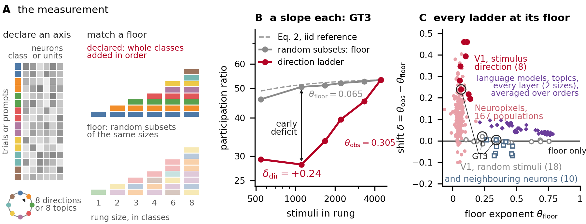

# Structure is in the zoom

**Probing neural symmetry through dimensionality scaling.** Adil Amin, ZEHEN Labs. NeurReps 2026 workshop
(Proceedings of Machine Learning Research). This repository is two things: `rung`, the paper's measurement released as a
tested tool, and the code and data behind every number in the paper.



## What rung reads

A dimensionality-scaling exponent, the slope of the participation ratio against subsample size on log-log axes, is
reported for neural populations and for the layers of language models as if the number belonged to the system. It
measures the population and the probe together. One recording of 11,311 mouse V1 neurons returns 0.25 when stimuli are
added at random, 0.30 when stimulus directions are added class by class, and 0.35 when neighbouring neurons are added.
Two of the three numbers are floors: what random subsets of the same sizes return through the same estimator. Direction
alone leaves its floor (0.305 = a floor of 0.065 + a shift of 0.240).

`rung` splits a reported exponent before it is compared, for any samples-by-features array with one label per row and
for every layer of a language model at any training checkpoint, with no probe or model trained. It returns the **floor** and the
**shift** δ against label and nuisance nulls, splits the shift into what the class means and the fluctuations carry,
reads the symmetry sectors of a cyclic axis and compares candidate labels. The exact identity
`theta_obs = theta_floor + delta` holds whenever the declared ladder and its floor share rung sizes.

The shift is an analysis, not a detector: it says how much of a reported exponent a declared label makes, and what sets
it. A decoder asks whether a label can be read out; the two answer different questions and complement each other (see
*What the paper shows*). The grouping of samples into classes carries the shift; the order in which the classes are
added moves it little, so for unordered classes `rung` reports the order-averaged shift beside the declared one.

## Install and run

```bash
pip install git+https://github.com/adilamin89/structure-in-the-zoom     # numpy core
rung data X.npy labels.npy --out r.json --plot r.png                     # any samples-by-features array; labels = integer class ids, one per row
rung summarize r.json                                                    # the reading, in plain language
```

For a language model, clone the repository (the paper's prompt axes live in `axes/`) and add the model extras:

```bash
git clone https://github.com/adilamin89/structure-in-the-zoom && cd structure-in-the-zoom
pip install -e ".[models]"                                    # + torch, transformers, datasets
rung llm --model EleutherAI/pythia-160m --axis axes/language_type.json --device mps --out lt.json   # --device cpu | mps | cuda
rung plot lt.json --out lt.png                                # the depth profile with both null bands
rung summarize lt.json                                        # the reading, layer by layer
```

`theta-zoom`, the tool's name through 1.1.0, stays as an alias for one release.

## Two worked examples

**A recording.** Trials by neurons (from an NWB file, build the trials-by-units count matrix with `pynwb` and save it as
`.npy`; from `.mat`, `scipy.io.loadmat`), one drift direction per trial in eight classes at 45°, in angular order, with
the antipodal pairs written down.

```bash
python -c "import json; json.dump({c: (c + 4) % 8 for c in range(8)}, open('pairs.json', 'w'))"
rung data resp.npy direction.npy --antipode pairs.json --sectors --decompose --cov-floors --out v1.json --plot v1.png
rung summarize v1.json
```

The summary gives the floor, the shift and its permutation p; the deficit at every rung and the share of the climb left
after four classes, read as the stall test; the sector balance of the class-mean kernel and its even and odd amplitudes;
the split, which says whether the shift is the pooling of fluctuation modes private to each class (`D`, the finding on
V1) or the class means (`Tb`); and, with `--cov-floors`, the principal-angle dissimilarity between classes against its
own label-blind floor. Pass the session or animal as `--strata` when trials are not exchangeable across it. To compare
the direction-selective, random and least-selective thirds at matched size, pass the tuned neurons only (with
`--split-by` scores of their direction selectivity): `split_by` ranks every feature it is given.


**A model.** An axis is a JSON file `{"class": ["prompt", ...], ...}`; eight classes, sixteen or thirty-two prompts per
class, the hidden state at the last token of every layer. `--paper-seeds` reproduces the paper's cells.

```bash
rung llm --model EleutherAI/pythia-160m --axis axes/world_knowledge32.json --paper-seeds --match-last-token --out lm.json
rung summarize lm.json
```

Declared topics lift every layer, more with depth; `--match-last-token` adds, at every layer, subsamples matched on the
number of distinct final tokens per class and size-matched random subsamples, so the lexical part of a lift is the drop
from the second to the first. For checkpoints, add `--revision` (`step1000`, `step143000`); for a site other than the
residual stream, collect one feature vector per prompt at that site (an attention head's output, an MLP's neurons, a
sparse autoencoder's latents) and call `zoom(X, labels)` on it. `rung axis --dataset ... --text-field ... --label-field
... --out my.json` builds an axis from any Hugging Face dataset, with `--strata-field` for the nuisance sidecar.

Two minimal-pair benchmarks ship the same way: `axes/blimp_grammaticality.json` (four BLiMP paradigms, good and bad as
classes) and `axes/baroni_complexity.json` (three syntactic-complexity contrasts at 64 pairs), each with a
`.strata.json` holding the pair, so `rung llm` reads the grammaticality signal against the within-pair swap null out of
the box. Because the strata pair the classes, the result also carries the pair-preserving order average. The two planted
axes `axes/compass.json` and `axes/clock.json` (eight class tokens rotated inside sixteen shared carrier sentences) are
what the second null is for: the carrier-stratified null returns them to zero.

## What it returns

For one array and one axis (`rung data`, or `zoom(X, labels)` in Python):

- `theta_floor`, `delta`: the floor and the shift, with `theta_obs = theta_floor + delta` exact;
- `p_two`, `z`: the shift against the label-permutation null (500 permutations by default);
- `delta_orderavg`, `p_two_orderavg`: the shift averaged over fifty random class orders, the statistic for a partition
  whose classes have no natural order;
- `strat_p_two` when strata are given: the shift against the nuisance-preserving null;
- the ladder itself: `pr_obs` and `pr_floor` at every rung, `deficit` (the log participation ratio of the accumulated
  classes below the floor, zero at the top rung) and `late_fraction`, the share of the climb that the second half of the
  classes still carries. With `--antipode pairs.json` (`{class: its antipodal class}`) `late_fraction` is the stall test:
  a code that has every class mean by half the classes has nothing left to climb there; a code that distinguishes a class
  from its antipode still does.

Before any of that, `rung data` prints the **spectrum**: the array's full effective dimension, the variance fraction of
its leading eigenvalue and of its largest single feature. A population dominated by one direction blinds any spectral
functional; `--standardize` z-scores every feature first and is the repair.

Further readings, each one flag:

- `--decompose` (`decompose(X, labels)`): the exact four-term split of every rung's deficit and of the shift into a trace
  term, a fluctuation-pooling term, a between-class term and a mean-fluctuation coupling, regrouped into two scale-free
  pieces, the change in the pooled within-class effective dimension `D` and the trace share of the class means `Tb`, with
  the private slope of `D` against log(k/K) (1 when every class brings its own fluctuation subspace, 0 when the
  variability recurs across classes) and, with `--n-shuffle`, every term net of label permutations. It also prints the
  **sign law** of the split: at the full set, the class-mean term is negative exactly when PR(W)/PR(B) exceeds
  1 + 2(1 - a) Tr W/Tr B, where a = Tr(WB) PR(W)/(Tr W Tr B) is the alignment of the class means with the dominant
  fluctuations. `--n-bias 3` adds the **finite-sample bias null**: surrogates with the data's class means, class sizes and
  class variances and one covariance shape for every class; the within part `D` is read net of it.
- `--sectors` (`sectors(X, labels)`): for a cyclic axis, with the labels in cyclic order, the harmonics of the class-mean
  kernel: the coefficients (for eight classes a, c1, b2, c3, b4), the sector balance b2/|c1|, the even and odd amplitudes
  and the coherence of adjacent and of antipodal classes.
- `--cov-floors` (`cov_floors(X, labels)`): the principal-angle dissimilarity between classes (one minus the mean squared
  cosine between their top `--cov-k` residual directions, averaged over class pairs) against its own label-blind floor,
  often most of its raw value at the trial counts experiments use. Two label-blind classes are independent samples of
  one distribution, so an elliptical random-matrix model, the pooled spectrum with a trial gain of the measured kurtosis,
  predicts the floor without permutations. The run reports the observed value, the floor, the floor of the spectrum
  alone, the floor-corrected value and the structure part (observed - floor) / (1 - floor); compare corrected or
  normalized values across designs, never raw ones. The model fits best where trial-to-trial variability is a shared
  gain; spike counts mix gain with private noise, so there `--cov-perm 50` adds the permutation floor to check it.
- `--null-shift`: when the labels are in time order (one per frame), a circular shift of the whole label sequence as the
  second null, which keeps the labels' autocorrelation and breaks only their alignment with the frames.
- `--time-blocks 48` (or a file of block ids, rows in acquisition order): labels permuted only within contiguous blocks,
  which keeps what drift and slow state can do. Every run reports how often consecutive rows share a class against the
  label-blind expectation and warns when labels cluster in time.
- `--valid mask.npy`, or `--sample-times times.npy --invalid-intervals bad.npy` (`valid_from_intervals`): samples a data
  release marks invalid are dropped before every statistic, and the result records how many were kept.
- `--order sequential|antipodal|<list>` sets the declared accumulation order; `--split-by scores.npy` runs the top,
  bottom and a random third of the features at matched size, each with its own floor.

`rung data` also prints the shift of the per-feature z-scored array beside the linear one; `rung llm --frames both` (the
default) reports both frames at every layer and flags layers where they disagree in sign. `rung llm` reports the
distinct last tokens per class and warns when a class ends on few of them; `--dtype bf16` repairs float16 overflow in
early training checkpoints. `rung summarize` turns a result into sentences under the rules below; `rung plot` draws the
ladder figure for an array and one panel per axis for a model, with both null bands.

## Reading the numbers

1. **Declare before you look.** Classes, class count and accumulation order are fixed first.
2. **Six or more classes, ten or more samples per rung.** A two-class ladder fits a slope through two points.
3. **For unordered classes, read the order-averaged shift.** The declared-order profile is a property of one path.
4. **Pass your nuisance structure as strata.** If the shift survives the within-stratum permutation, the label is doing
   work; if the stratified null absorbs it, the signal is composition.
5. **Read the spectrum first**, and standardize when one direction dominates.
6. **Compare subsets at matched size only.** The shift depends on the number of features.
7. **Read `D` and `Tb`, not the raw pooling and trace terms,** wherever the within-class scale changes with the class.
8. **Sample each class well before reading the split.** In the paper's grating recordings the within-class part turned positive
   only once each class held 0.46 to 1.2 times its own fluctuation dimension in samples. The floor's first rungs estimate the
   pooled fluctuations, of dimension about m PR_class with m = K/[1+(K-1)σ] (σ the classes' mean fluctuation overlap), from as
   many samples as a declared rung spends on one class, so `D` sits below its population value, by about (m-1) PR_class/(n ln K)
   at n samples per class (an endpoint, first-order estimate), while the class-mean terms (`Tb + Cb + Cx`) move the other way.
   Evaluated at each rung's sample counts (`scripts_canonical/finite_n_identity.py`), the identity puts the within-class part of
   eight equal Gaussian classes of PR_class = 30 within 0.05 of the population identity's value on the same rungs once a class
   holds about 20, 8 and 3 times PR_class samples at σ = 0.2, 0.44 and 0.7, at higher ratios n/PR_class for classes of
   lower PR. Compare the samples per class with PR(W), which the sign-law line prints; `--n-bias` measures the part that
   remains when every class has one covariance shape.
9. **For a depth profile, the inference is on the profile**, the integrated excess of the shift over its embedding value
   against the permutation null, not on a count of significant layers.
10. **Report a model's shift in both frames.** Where the linear and the z-scored readings disagree in sign, the linear one
    follows a few high-variance units.
11. **The shift reads how classes spread, not a consistent offset.** Classes that differ only by the same small direction
    between near-identical items give the shift nothing to read, while a linear probe can still find that direction.
12. **Any covariance statistic inherits a floor.** Read a principal-angle or other covariance comparison against its
    label-blind floor (`--cov-floors`) before comparing it across designs.

## What the paper shows

- **There is no probe-free exponent.** The GT3 recording's three exponents split exactly into floor and shift: random
  stimuli 0.253 (floor 0.232, shift +0.020), neighbouring neurons 0.346 (floor 0.342), direction 0.305 (floor 0.065,
  shift +0.240). Random stimulus subsets stay at their floors in all 18 recordings (mean shift -0.002).
- **Direction lifts every grating recording**, from 0.20 (low contrast) to 0.45 (localized), above all 200 label
  permutations; classes added in random orders give shifts of the same size, so the grouping carries it. The shift reads
  the orientation and direction sectors of the tuning and is larger in the most direction-selective neurons.
- **What carries it.** Direction-dependent fluctuations around the class means lift the exponent, while in these
  recordings the class means pull it down. Two measured terms give the shift's sign with nothing fitted: one from how
  much the classes' fluctuations overlap, one from how the class means sit against them.
- **Two more laboratories.** In Allen Neuropixels spike counts the shift is positive in 32 of 32 mice in primary visual
  cortex and in 158 of 167 populations across visual areas; the two terms, predicted from each population's counts,
  give its sign in 152 of 167. Allen's largest fluctuations are shared, untuned modes that partly track running and
  pupil; the class-mean term reverses there. The same terms predict macaque V1 and lattices of known structure.
- **What the shift adds.** Linear decoders read the class means. With the means projected out they fall to chance while
  the shift survives, and a quadratic decoder given each class's covariance still reads direction (accuracy 0.21 to
  0.69; chance 0.125). Other covariance statistics inherit floors too: a median 69% of the principal-angle dissimilarity
  across the 167 Allen populations is label-blind floor, which the random-matrix model predicts within a median 2% of the
  permutation floors in imaging and 6% in Allen spike counts.

Every number above is read from its artifact by `tests/test_readme_numbers.py`.

## Further analyses in this repository

The repository also carries analyses that are not in the camera-ready: the language-model battery at four Pythia sizes
and five architectures (content axes inherited from the tokens, construction axes built with depth), the moral-concept
axis before and after instruction tuning, the BLiMP and Baroni minimal pairs read against their swap nulls, the
equivariant network whose invariant layers read zero, and the calibrated population models. Their scripts and artifacts
are listed in the second table below.

## What is where

```
rung.py                  the instrument: zoom(), decompose(), sectors(), cov_floors(), llm_battery(), build_axis(),
                         and the rung command line (data | llm | axis | plot | summarize); numpy core,
                         torch and transformers only for the model door
theta_zoom.py            alias of rung (the name through 1.1.0), kept for one release
tests/                   numpy-only pytest suite: the decomposition identity, significance on structured labels and its
                         absence on shuffled ones, the stratified null, the deficit ladder and the stall test, the split at
                         matched size, the sector fit, the declared orders, the circular-shift null, the validity mask, the
                         floor law, the command line end to end, and every number this README prints
render_all.py            prints the paper's tables and headline numbers from the artifacts
axes/                    every prompt in the paper, with strata sidecars; PROVENANCE.md gives origin and license per file
scripts_canonical/       one script per analysis, named for what it computes; each docstring names the artifact it
                         writes; make_fig_*.py regenerate the figures from the artifacts
data_canonical/          the result files behind every reported number
figures_canonical/       the figures
pyproject.toml           pip install -e . gives the rung command (and theta-zoom as an alias)
```

Raw neural data are public and not included. The grating and static recordings are the Figshare release 8279387 of
Stringer et al. (2021, Cell); the spontaneous sessions the release of Stringer et al. (2019, Science); the Allen Brain
Observatory Neuropixels visual-coding sessions; the CRCNS pvc-11 macaque arrays (Kohn and Smith 2016,
doi:10.6080/K0NC5Z4X). The scripts read `raw/`: each grating or static session as `raw/<session>.npy` (a dict with
`sresp`, neurons by presentations, `istim`, the stimulus angle, and `stat`, cell positions), spontaneous sessions under
`raw/spont/`, the pvc-11 arrays under `raw/pvc11/spikes_gratings/`, and the per-session Allen spike counts and running
speeds under `raw/allen_counts/` and `raw/allen_running/` (written from the NWB files by `allen_counts_local.py`, or
on a cloud runner by `allen_counts_modal.py` and `allen_running_modal.py`). Language-model hidden states go to
`raw/llm_states/` (`llm_battery.py encode`, `llm_encode.py`; several GB). Each docstring names the files it reads.

### Allen invalid intervals

Every Allen number excludes what the release itself marks invalid: presentations that overlap an `invalid_times` interval
tagged with the population's probe (the probe sent no data), `all_probes` or `stimulus`; units on electrodes with
`valid_data` False; and presentations in which a population whose valid-time rate predicts 10 or more spikes fires none
(one population, session 743475441 VISp, is silent before 2135 s without a flag). `allen_fetch_nwb.sh` fetches the 32
session NWBs into `raw/allen_nwb/`; `allen_invalid_map.py` writes the per-population masks to `data_canonical/allen_masks/`
(shipped). `allen_engine.pop_view` takes every Allen generator's presentations and units through the masks;
`ALLEN_VARIANT=none` reproduces the unmasked values, `A` uses the release's flags alone, `B` (the default) is the paper.
The `allen_*_local.py` scripts run the cloud-run Allen generators on the local counts through the same path; unmasked,
they reproduce the cloud outputs to 5e-7. `rung --invalid-intervals` applies the same exclusion to any recording.

The Allen two-term predictions in `allen_twoterm_predictions.json` were written by `allen_twoterm_predict.py` and
committed before the measured Allen results were compared with them; the two-term figure (`make_fig_twoterm.py`)
shows both.

### Claim, artifact, script: the paper

| Claim | Artifact | Script |
|---|---|---|
| Random-stimulus ladders sit at their floors in 18 recordings; the floor follows the sampling crossover | stringer_theta_decomposition.json, withinclass_shuffle_identification.json, floor_crossover.json | random_zoom_all_recordings.py, withinclass_shuffle_identification.py, floor_crossover.py |
| Direction lifts every grating recording, above all 200 label permutations | run38_v1_label_permutations.json, orientation_zoom.json | run38_v1_label_permutations.py, shuffle_label_control.py |
| The order of the classes moves the shift little; the order effect over sixteen origins and its two parts | cr_order_effect_origins.json, fluctuation_overlap_profile.json | cr_order_effect_origins.py, fluctuation_overlap_profile.py, cr_appE_class_means.py |
| Neighbouring neurons stay near their floor | neuron_zoom_spatial.json | spatial_neuron_ladder.py, exchangeable_neuron_zoom.py |
| The two symmetry sectors; the most direction-selective third shifts more, also cross-fitted | multipole_harmonics_8dir.json, run59_shift_by_direction_selectivity.json, cr_ds_thirds_crossfit.json | multipole_harmonics_8dir.py, run59_shift_by_direction_selectivity.py, cr_ds_thirds_crossfit.py, make_fig_multipole.py |
| The exact split of the shift into a within-class and a class-mean part | run72_paper_designs_split.json | run72_paper_designs_split.py |
| What carries the shift: within-class shuffle, pooled fluctuations, tuning inside each bin removed | cr_withinclass_controls.json, cr_order_and_withinbin_controls.json, withinclass_shuffle_identification.json | cr_withinclass_controls.py, cr_order_and_withinbin_controls.py, withinclass_shuffle_identification.py |
| The overlap law and the class-mean term; the sign law and the alignment a | overlap_identity_checks.json, overlap_identity_followup.json, classmean_sign_condition.json, classmean_fluctuation_alignment.json, signal_noise_alignment.json | overlap_identity_checks.py, overlap_identity_followup.py, classmean_sign_condition.py, classmean_fluctuation_alignment.py, signal_noise_alignment.py, make_fig_overlap_laws.py |
| The two terms against the shift: imaging, Allen, macaque, lattices | twoterm_imaging.json, allen_twoterm_predictions.json, allen_sessions/session_*.json, macaque_pvc11_twoterm.json, xy_twoterm.json, xy_polar_twoterm.json | make_fig_twoterm.py, twoterm_imaging.py, allen_twoterm_predict.py, allen_run.py, macaque_pvc11_twoterm.py, xy_twoterm.py, xy_polar_twoterm.py |
| Allen with temporal frequency separated: per-session shifts, splits, controls, verdicts and misses | allen_sessions/session_*.json, allen_verdicts.json, allen_twoterm_misses.json, allen_miss_threshold.json | allen_run.py, allen_engine.py, allen_score.py, allen_twoterm_misses.py, allen_miss_threshold.py |
| Allen's state modes held out, running, pupil and lagged state | allen_heldout_modes.json, allen_heldout_modes_mechanism.json, allen_heldout_modes_control.json, allen_modes_removed.json, allen_modes_running.json, allen_modes_pupil.json, allen_modes_state_basis.json | allen_heldout_modes.py, allen_heldout_modes_mechanism.py, allen_heldout_modes_control.py, allen_modes_removed.py, allen_modes_running.py, allen_modes_pupil.py, allen_modes_state_basis.py |
| Choosing an axis among candidates on half the Allen mice | allen_axis_screen.json, allen_axis_screen_rescore.json, allen_axes_halves.json | allen_axis_screen.py, allen_axis_screen_rescore.py, allen_axes_halves.py |
| The Allen invalid-interval masks | allen_masks/, allen_invalid_map.json | allen_invalid_map.py, allen_fetch_nwb.sh, allen_engine.py |
| Macaque V1, three Utah arrays | macaque_pvc11.json, macaque_pvc11_twoterm.json | macaque_pvc11.py, macaque_pvc11_twoterm.py |
| What the shift adds: decoders, the means projected out, decoding against the means' strength | meanfree_shift_exact.json, meanfree_shift.json, meanfree_crossfit.json, decoding_vs_beta.json, v1_decoders.json | meanfree_shift_exact.py, meanfree_shift.py, meanfree_crossfit.py, decoding_vs_beta.py, v1_decoders.py |
| Floors under other covariance statistics, and the floor law | allen_covariance_floors_decoders.json, covariance_floors_trial_ladder.json, principal_angle_floor_imaging.json, principal_angle_floor_allen.json | allen_covariance_floors_decoders.py, covariance_floors_trial_ladder.py, principal_angle_floor_law.py, principal_angle_floor_imaging.py, principal_angle_floor_allen.py |
| Lattices and constructed systems of known structure | lattice_ground_truth_score.json, xy_groundtruth.json, xy_onset.json, ising_spectral_account.json | lattice_ground_truth.py, lattice_ground_truth_score.py, xy_groundtruth.py, xy_onset.py, xy_split.py, ising_spectral_account.py |
| Language models: the topic and construction lifts at four Pythia sizes, last-token controls, probes, sparse autoencoders, a known circuit, other architectures | llm_battery_*.json, llm_lasttoken_*.json, llm_lasttoken_fractions.json, llm_probes_*.json, llm_sae.json, llm_ioi.json, llm_architectures_*.json, llm_path_nulls.json | llm_battery.py, llm_lasttoken.py, llm_lasttoken_fractions.py, llm_probes.py, llm_sae.py, llm_ioi.py, llm_architectures.py, llm_path_nulls.py, llm_score.py |
| Worked examples (`rung` on GT3 and on Pythia-160m) | worked_example_gt3_rung160.json, appm_lm_check.json | worked_example_lm_check.py |
| Appendix checks: coarse-graining, finite size, synthetic tuning width, the exact floor inverse | cr_graining_table.json, cr_finite_size_split.json, kappa_sweep.json, appendix_exception_tests.json | cr_graining_table.py, cr_finite_size_split.py, kappa_sweep.py, appendix_exception_tests.py |

### Claim, artifact, script: further analyses

| Analysis | Artifact | Script |
|---|---|---|
| Ladder-design variants; the axis search on static, natural-image and spontaneous sessions | run8_ladder_robustness.json, run27_static_axis_search.json, run40_spont_state_axis.json | run8_ladder_robustness.py, run27_static_axis_search.py, run40_spont_state_axis.py |
| The accumulation-order contrast; the sector balance under blocking; anatomical blocks | antipodal_order.json, sector_balance_scale.json, run51_spatial_blocking.json | accumulation_order.py, sector_balance_scale.py, run51_spatial_blocking.py |
| The second laboratory's even-sector correlate | run1_allen_partial_mixed.json, run39_allen_aeven_mixed.json | run1_allen_partial_mixed.py, run39_allen_aeven_mixed.py |
| Ising and nematic lattices; the two-species lattice | ising_L128_tc.json, nematic_polar_delta.json, run62_two_species_xy.json | ising_L128_tc.py, nematic_polar_delta.py, run62_two_species_xy.py |
| The equivariant network: the invariant zero, the sector content, the reversed order | run5b_cnn_seeds.json, run5c_cnn_multipole_fixed.json, run12_cnn_ordering.json, run41_cnn_ordering_perseed.json | run5b_cnn_seeds.py, run5c_cnn_multipole_fixed.py, run12_cnn_ordering.py, run41_cnn_ordering_perseed.py |
| The calibrated and cell-built population models | run2b_corotating_seeds.json, run11b_fresh_draw_prediction.json, run60_mixture_model.json, cr_model_overlap_calibration.json, cr_model_overlap_square.json | run2b_corotating_seeds.py, run11_bootstrap_prediction.py, run60_mixture_model.py, cr_model_overlap_calibration.py, cr_model_overlap_square.py |
| The deficit split in the network, the second laboratory and the language models | run63_deficit_decomposition.json, run67_cnn_deficit_decomposition.json, run66_allen_deficit_decomposition.json, run65_pythia_deficit_decomposition.json | run63_deficit_decomposition.py, run67_cnn_deficit_decomposition.py, run66_allen_deficit_decomposition_modal.py, run65_pythia_deficit_decomposition.py |
| The language-model battery's robustness, the moral-concept axis, architectures, the blind probe, planted axes, minimal pairs | run20_robustness_battery.json, run44_base_instruct_ethical.json, run47_fourth_cell_redpajama.json, run53_mamba_fifth_cell.json, run55_blind_probe_physics.json, run28_cyclic_axis_llm.json, run42_blimp_battery.json, run43b_baroni_64pairs.json | run20_robustness_battery.py, run44_base_instruct_ethical.py, run47_fourth_cell_redpajama.py, run53_mamba_fifth_cell.py, run55_blind_probe_physics.py, run28_cyclic_axis_llm.py, run42_blimp_battery.py, run43b_baroni_64pairs.py |

## Citation

```bibtex
@inproceedings{amin2026zoom,
  author    = {Amin, Adil},
  title     = {Structure is in the zoom: probing neural symmetry through
               dimensionality scaling},
  booktitle = {Proceedings of the NeurReps Workshop (Symmetry and Geometry in Neural Representations)},
  series    = {Proceedings of Machine Learning Research},
  year      = {2026},
  note      = {Code and data: https://github.com/adilamin89/structure-in-the-zoom}
}
```

## License

Code: MIT (see `LICENSE`). Result artifacts in `data_canonical/` may be reused with attribution to the paper. Prompts
and stimuli carry their own terms: the three axes composed for the paper are CC BY 4.0; the benchmark-derived axes and
stored stimuli inherit their sources' licenses (TruthfulQA Apache-2.0, HellaSwag MIT, ARC CC BY-SA 4.0, ETHICS MIT,
BLiMP CC BY 4.0, Baroni et al. per their release). Origins, authorship and licenses are listed item by item in
`axes/PROVENANCE.md`.
