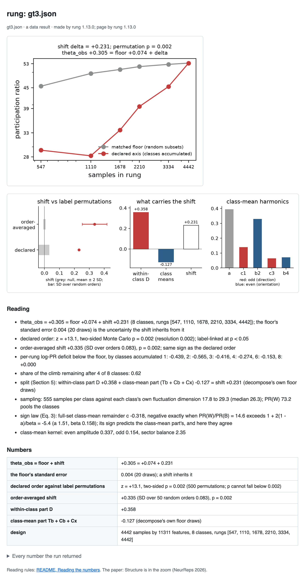
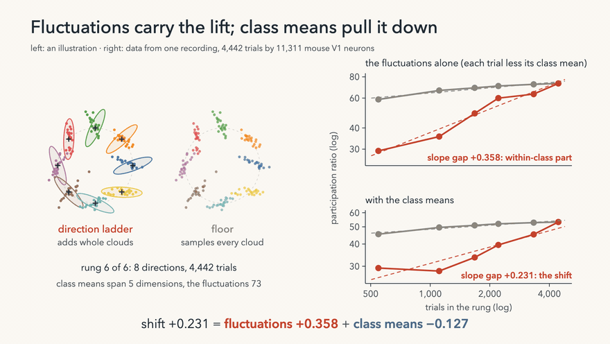
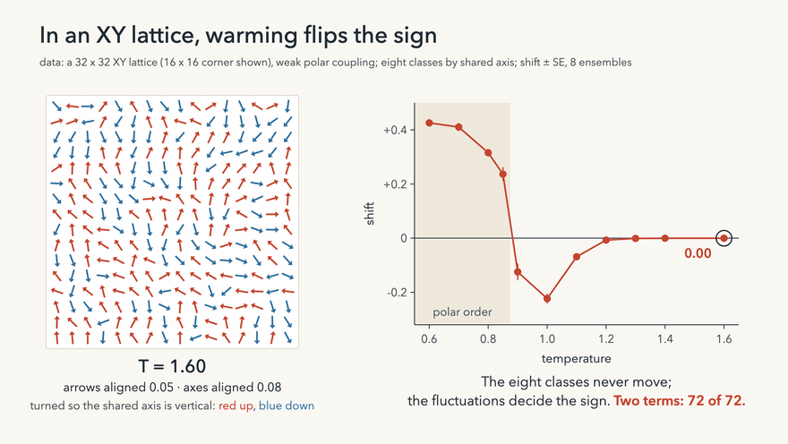
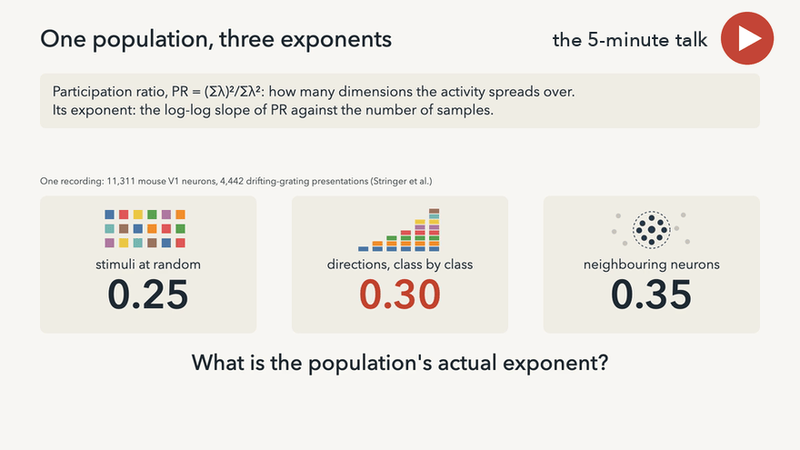

# Structure is in the zoom

[](https://youtu.be/S4kUtP37KLM)
[](https://colab.research.google.com/github/adilamin89/structure-in-the-zoom/blob/main/examples/quickstart.ipynb)
[](https://github.com/adilamin89/structure-in-the-zoom/tags)
[](https://github.com/adilamin89/structure-in-the-zoom/blob/main/LICENSE)


**`rung` tells you how much of a dimensionality exponent is sampling and how much is structure, and what carries the structure.**
Give it samples by features with a label per row: trials by neurons with their stimuli, or prompts by a language model's hidden
units or attention heads with their topic or answer. It splits the exponent into a floor, what random subsets of the same sizes give
with the labels ignored, and the shift your path through the labels adds; then it says whether the fluctuations within each class or
the class means carry the shift, and how far to trust it. Use it before you report an exponent, to find which of several labels
organizes a population, or to find the layers and heads of a model that a label organizes.

**Why: there is no probe-free dimensionality exponent.** You count how many dimensions a population's activity spreads over, its
participation ratio (Σλ)²/Σλ² over the covariance eigenvalues λ, on bigger and bigger subsets, and report the log-log slope as the
population's exponent. One recording of 11,311 mouse V1 neurons gives three: 0.25 when stimuli are added at random, 0.30 when drift
directions are added class by class, and 0.35 when neurons are added nearest neighbours first. Each is its path's floor plus the
shift that path adds.

The paper: *Structure is in the zoom: probing neural symmetry through dimensionality scaling* (Adil Amin, ZEHEN Labs; accepted at
NeurReps 2026, Proceedings of Machine Learning Research, to appear). If you use rung or its results, please cite it ([citation](#citation));
questions and bug reports go to the [issues](https://github.com/adilamin89/structure-in-the-zoom/issues).

**On this page:** [what it answers](#what-it-answers) · [quickstart](#quickstart) · [your data](#your-data) ·
[what the paper found](#what-the-paper-found-with-it) · [the talk](#the-talk) · [the approach](#the-approach)

## What it answers

**Is my exponent structure, or what random sampling gives anyway?** `rung data X.npy labels.npy` prints the floor (random
subsets of the same sizes, labels ignored), the shift your labels add, and how far the shift sits above label permutations.

**What carries the shift: the fluctuations within each class, or the class means?** `--decompose` splits it exactly into these two parts;
`--arm within` removes the class means and tests what is left.

**Which of my labels organizes the data?** `--candidates direction.npy contrast.npy session.npy --halves oddeven` ranks them,
chosen on one half of the rows and checked on the other.

**Is it the label, or slow drift, sessions or another nuisance?** `--time-blocks 50` permutes labels only inside blocks of 50
rows; `--strata sessions.npy` holds a nuisance fixed.

**Which layers or heads of a language model does a label organize?** `rung llm --model openai-community/gpt2 --axis
axes/ioi_names.json --heads` reads every layer and every attention head.

<details>
<summary>Main commands and options</summary>

| To find out | Run |
|---|---|
| how much of an exponent is floor, and how much a label adds | `rung data X.npy y.npy` |
| what carries the shift: the fluctuations or the class means | `--decompose` |
| the class means alone, or the fluctuations with the means removed | `--arm between`, `--arm within` |
| whether the two measured terms account for the shift | `--account` |
| which of several labels organizes a population | `--candidates` (`--halves`: pick on one half, check on the other) |
| the shift with a nuisance, acquisition blocks or time order held fixed | `--strata`, `--time-blocks`, `--null-shift` |
| what a ladder over neurons or features keeps | `rung features` |
| the shift at every layer of a Hugging Face model | `rung llm` (`--match-last-token` for the final-token control) |
| which attention heads, SAE latents or other units a label organizes | `rung llm --heads`, `rung heads` |
| spike counts, labels and times from an NWB file | `rung nwb` |
| the reading in plain words, and one HTML page | `rung summarize`, `rung report` |

[REFERENCE.md](https://github.com/adilamin89/structure-in-the-zoom/blob/main/REFERENCE.md) gives what each returns and what the
paper found with it.

</details>

## Quickstart

```bash
pip install "rung @ git+https://github.com/adilamin89/structure-in-the-zoom@v1.13.1"
# for rung llm and rung axis (adds torch, transformers and datasets):
pip install "rung[models] @ git+https://github.com/adilamin89/structure-in-the-zoom@v1.13.1"
```

Python 3.10 or later, with numpy, scipy and matplotlib; `rung[nwb]` adds h5py for NWB and MATLAB v7.3 files. The paper's prompt axes
(`axes/`) come with a clone of the repository, not with pip.

A toy that runs in seconds: eight classes with the same mean, each stretching its own four features.

```python
import numpy as np
rng = np.random.default_rng(0)
y = np.repeat(np.arange(8), 64)                          # 8 classes of 64 samples
X = rng.standard_normal((512, 64))
X *= 1 + 2 * (y[:, None] == np.arange(64) // 4)          # class c stretches features 4c to 4c + 3
np.save("X.npy", X); np.save("labels.npy", y)
```

```bash
rung data X.npy labels.npy --decompose --out toy.json
rung summarize toy.json        # the reading in plain words; rung report toy.json writes it as one page
```

```text
theta_obs = +0.511 = floor +0.271 + shift +0.240 (8 classes, rungs [64, 128, 192, 256, 384,
  512]); the floor's standard error 0.003 (20 draws) is the uncertainty the shift inherits
  from it
  ⋮
split (Section 5): within-class part D +0.212 + class-mean part (Tb + Cb + Cx) +0.028 =
  shift +0.240 (decompose's own floor draws)
```

The rungs are the ladder's steps, here the samples of the first 1, 2, 3, 4, 6 and all 8 classes. `split` divides the shift into
the within-class part D, from the fluctuations around each class mean, and the class-mean part Tb + Cb + Cx: the class means' share of the trace, their own
concentration and their overlap with the fluctuations (Section 5 of the paper defines the split, Appendix M the four terms). The split
draws its own floor ('decompose's own floor draws'), so its total can differ from the first line's shift in the third decimal. The toy's classes differ only in how their fluctuations are stretched, and the reading agrees: of the shift
+0.240, the within-class part D is +0.212, and the class-mean part, +0.028, matches what the same split gives with the
labels shuffled (+0.026).

### Reading a real result

On the paper's recording (GT3 from Stringer et al. 2021; [REFERENCE.md](https://github.com/adilamin89/structure-in-the-zoom/blob/main/REFERENCE.md#worked-examples)
and the quickstart notebook build the two inputs from the public download in four lines), the lines that matter are these:

```text
$ rung data gt3_X.npy gt3_labels.npy --sectors --decompose --out gt3.json
$ rung summarize gt3.json
theta_obs = +0.305 = floor +0.074 + shift +0.231 (8 classes, rungs [547, 1110, 1678, 2210,
  3334, 4442]); the floor's standard error 0.004 (20 draws) is the uncertainty the shift
  inherits from it
declared order: z = +13.1, two-sided Monte Carlo p = 0.002 (at its floor 1/(500 + 1): no
  permutation reached the observed value); label-linked at p < 0.05
  ⋮
split (Section 5): within-class part D +0.358 + class-mean part (Tb + Cb + Cx) -0.127 =
  shift +0.231 (decompose's own floor draws)
```

- `theta_obs = floor + shift`: the rungs hold the trials of the first 1, 2, 3, 4, 6 and all 8 directions; random subsets of the
  same sizes give 0.074 of the exponent 0.305, and adding whole directions class by class gives the other +0.231. One
  direction's trials span 29 dimensions where random trials from all eight span 45; both ladders end at the full set's
  53, so the direction ladder climbs further.
- `z = +13.1`: the shift sits 13 standard deviations above the same ladder with the labels permuted. The declared order adds the
  classes in their labels' order (directions 0 to 7 here); a p at its floor means no permutation reached the observed shift.
- `split`: the fluctuations within each direction carry the shift (the within-class part D, +0.358), and the class means pull it
  down (the class-mean part Tb + Cb + Cx, -0.127).

A shift has no universal scale: read it against its own permutations (z, p) and the floor's standard error, which the first two lines
print.

<details>
<summary>The full reading, the report page and the floor's draws</summary>

```text
$ rung summarize gt3.json
theta_obs = +0.305 = floor +0.074 + shift +0.231 (8 classes, rungs [547, 1110, 1678, 2210,
  3334, 4442]); the floor's standard error 0.004 (20 draws) is the uncertainty the shift
  inherits from it
declared order: z = +13.1, two-sided Monte Carlo p = 0.002 (at its floor 1/(500 + 1): no
  permutation reached the observed value); label-linked at p < 0.05
order-averaged shift +0.335 (SD over orders 0.083), p = 0.002; same sign as the declared
  order
per-rung log-PR deficit below the floor, by classes accumulated 1: -0.439, 2: -0.565, 3:
  -0.416, 4: -0.274, 6: -0.153, 8: +0.000
share of the climb remaining after 4 of 8 classes: 0.62
split (Section 5): within-class part D +0.358 + class-mean part (Tb + Cb + Cx) -0.127 =
  shift +0.231 (decompose's own floor draws)
sampling: 555 samples per class on average against each class's own fluctuation dimension
  18.9 to 32.1 (median 29.0, from split halves); PR(W) 73.2 pools the classes
sign law (Eq. 3): full-set class-mean remainder c -0.318, always negative here: it is
  negative when PR(W)/PR(B) exceeds 1 + 2(1 - a)/beta, a threshold below zero (-5.4) because
  the means' alignment a 1.51 exceeds 1 + beta/2 = 1.08 (beta 0.158), so any ratio exceeds
  it (here 14.6); its sign predicts the class-mean part's, and here they agree
class-mean kernel: even amplitude 0.337, odd 0.154, sector balance 2.35
```

`rung report gt3.json` writes the same as one page:



This run uses rung's default floor of 20 random ladders, shift +0.231. A shift moves with its floor's random draws: the paper prints
this ladder's shift at +0.231 to +0.240 under different draws (+0.240 in Figure 1), all within 1.5 standard deviations of the mean
over 20 seeds of the default floor, +0.234 ± 0.004; `--paper-floor` replays Table 9's +0.233
([PAPER.md](https://github.com/adilamin89/structure-in-the-zoom/blob/main/PAPER.md#rung-against-the-paper)).

</details>

### What to do next

`rung data` prints a few checks as it runs and `rung summarize` the reading; each row below gives what a line means and the option
that answers it.

| When the output says | it means | next |
|---|---|---|
| `not separated from the label-permutation null` | the shift is within what permuted labels give, at this design and permutation budget | screen other labels (`--candidates`); with `--decompose`, read the `sampling` line |
| `unresolved: ... permutations cannot give p below ...` | the permutation budget cannot reach p < 0.05 | `--n-perm 200` or more |
| `OPPOSITE sign to the declared order`, `read the order-averaged shift` | the declared shift depends on the order the classes are added in | report the order-averaged shift, the mean over random class orders (rule 3) |
| `negative shift` | the class ladder's exponent sits below its floor | `--decompose`: the split, and the sign law (where the class means sit against the strongest fluctuations), show which terms pull it down |
| `sampling: ... reads low` | some classes hold no more samples than their own fluctuation dimension (the participation ratio of a class's trials around their mean), so the within-class part reads low | more samples per class; `--decompose --n-bias 10` reads the split against a surrogate that keeps every class mean and gives all classes one fluctuation shape, sampled the same way (rule 8) |
| `one dimension dominates` | one covariance direction holds over half the variance | `--standardize` if a few features cause it (rule 5) |
| `OPPOSITE sign to the linear frame` | the sign depends on how the features are scaled | report both frames (rule 10) |
| `ABSORBED by within-stratum relabelling` | the shift stays compatible with the nuisance's composition | it cannot be credited to the label beyond the strata (rule 4) |
| `split (Section 5): within-class part D ... + class-mean part ...` | how the shift divides between the fluctuations within classes and the class means | `--arm between` tests the class means' share of the variance and `--arm within` the shift with the class means removed, each against its own null |

### From Python

```python
import numpy as np
from rung import zoom, decompose, summarize_data

X, y = np.load("X.npy"), np.load("labels.npy")      # samples by features, one integer label per row
r = zoom(X, y)                     # floor, shift, label-permutation z and p, order-averaged shift
r["decompose"] = decompose(X, y)   # the within-class part D and the class-mean part
summarize_data(r)                  # prints the reading, as rung summarize does
```

`zoom` returns a dictionary: `theta_obs`, `theta_floor` and `delta` (the shift), `z` and `p_two` against the label permutations,
`delta_orderavg`, and the ladders (`rung_sizes`, `pr_obs`, `pr_floor`); `decompose(...)["delta_split_free"]` holds `D` and the
class-mean terms `Tb`, `Cb`, `Cx`. The draw counts are the command line's (500 permutations, 50 orders, 20 floor draws) but the seeds
differ, so the split can move in the third decimal; `decompose(X, y, seed=0, n_shuffle=5)` repeats the command line's split.
`summarize_data` prints the reading and returns its lines and a verdict dictionary. The
[quickstart notebook](https://github.com/adilamin89/structure-in-the-zoom/blob/main/examples/quickstart.ipynb) runs the toy, its
reading and this code in Colab.

## Your data

**Inputs.** `X` is samples by features (trials by neurons, prompts by hidden units, images by channels) as .npy, .npz:key,
.mat:variable (naming one array in the file), .csv or .txt (`--transpose` if it is stored features by samples); it must be finite:
drop rows with NaN or inf, or mark them invalid with `--valid`. Labels give one class per row, as integers or
words; words are coded in sorted order, which is the declared order unless `--order` names another. A continuous variable, such as an
angle or a time, is cut into classes first, and how it is cut is part of the probe (REFERENCE.md cuts GT3's drift directions into
eight 45° bins); a numeric label with a fractional value, such as 0.5, stops the run instead of being merged into a class.

- **Spikes in an NWB file:** `rung nwb session.nwb --intervals trials --label direction --out s` writes `s_X.npy` (trials by units),
  `s_labels.npy` and `s_times.npy` for `rung data` (`--units-where location=VISp` keeps one area); when the file marks invalid
  intervals it also writes `s_invalid.npy`: filter it by the tags in `s_meta.json`, then pass it with
  `--sample-times s_times.npy --invalid-intervals s_invalid.npy`.
- **A language model:** an axis is a JSON file, `{"topic": ["prompt", ...], ...}`; a clone's `axes/` holds the paper's, and `rung axis`
  builds one from a Hugging Face dataset. `rung llm --model EleutherAI/pythia-160m --axis axes/world_knowledge32.json
  --match-last-token --out lm.json` reads the embedding and every layer at each prompt's last token (prompts cut at 128 tokens,
  `--max-len`), with the final-token control; in rung 1.11's benchmark it took 47 s of one laptop core, model encoding included.
  `--device mps` or `cuda` runs larger models.

**What rung needs.** rung computes a shift from three rungs up; read one from six or more classes and ten or more samples per rung
(rule 2). The split converges slowly: in rule 8's simulations of eight Gaussian classes it came within 0.05 of
its population value only once each class held about 3 to 20 times its own fluctuation dimension in samples, depending on how much the
classes overlap (`rung summarize` prints the dimensions), so read it against the surrogate (`--n-bias`) unless the classes are sampled
far beyond that. rung works on the samples' Gram matrix, so memory and time grow with the
square of the number of samples (the Gram alone is 8n² bytes, 0.16 GB for GT3's 4,442); Appendix M's command for GT3 (200 permutations) took 48 s of one laptop core in rung 1.11's benchmark.

**Outputs.** `--out r.json` holds the result's numbers; `rung summarize r.json` reads it in plain words, `rung report r.json` writes one
self-contained HTML page (figure, reading, numbers), and `rung plot r.json --out r.png` the figure alone.

## What the paper found with it

### The floor

Random-stimulus exponents, 0.11 to 0.75 across all 18 imaging recordings, sit on their floors (mean shift -0.002): random
sampling alone gives them, and so does adding neighbouring neurons (0.346 against a floor of 0.342 in the recording above). Adding directions
class by class lifts the exponent above its floor in all eight grating recordings and 158 of 167 Neuropixels populations (temporal
frequencies pooled), and eight topics lift every layer of Pythia-160m and 2.8B (averaged over class orders).

<details>
<summary>Figure 1 of the paper: every ladder's shift against its floor</summary>


<sub>(A) A declared axis adds whole classes in order; its floor draws random subsets of the same sizes. (B) The recording above:
the floor (grey) and the direction ladder (red), whose slopes split as θ<sub>obs</sub> = θ<sub>floor</sub> + δ. (C) Every ladder's
shift against its floor. On the zero line an exponent is all floor; above it, directions lift all eight grating recordings and
158 of 167 Neuropixels populations (temporal frequencies pooled), and topics every layer of Pythia-160m and 2.8B (averaged over
class orders).</sub>

</details>

### What carries the shift



The fluctuations within each class carry the shift, and the class means pull it down. Each direction's trials form a cloud
stretched its own way, so every new direction adds dimensions the others held weakly, while the class means stack variance onto a
few strong ones. The within-class part runs +0.29 to +0.64 across the eight grating recordings and the class-mean part -0.08 to
-0.35; remove the class means from every trial and linear decoders fall to chance, while the shift still clears the paper's
permutation test in every half of every recording, and rung 1.13's calibrated null in 31 of the 32 halves.

### When the sign changes



Class means along the strongest fluctuations stack variance onto them and tend to lower the exponent; means along weak ones fill
those dimensions and tend to raise it. In the XY lattice the classes lie on the same orbit at every temperature and the fluctuations decide the
sign: positive while polar order holds, negative from T = 0.9 to 1.1 as it melts, near zero above, and the two terms give its sign
in all 72 lattice and spin-wave ensembles. In recordings the two terms, computed at the rungs' own sample counts, get the sign in
163 of 167 Allen Neuropixels populations with each direction's temporal-frequency tuning removed, including 14 of the 16 negative
ones (always guessing positive gets 151). In mean field they also give the signs of all three macaque V1 arrays from a
third laboratory, one of them negative (-0.35).

### Inside a language model

At one layer, each prompt is a point: the model's hidden state at its last token. The ladder adds the prompts topic by topic; its
floor adds random prompts of the same counts, with the topics mixed. A positive shift says the topics bring dimensions faster than
random prompts do, through where they sit or through how their prompts vary; the split and a surrogate say which (the clouds above read V1
the same way, with trials for prompts and neurons for hidden units).


In Pythia-2.8B (deduped) the topics differ in how their prompts vary, as V1's directions do. Give every topic one shared
fluctuation shape while keeping its centre (a surrogate; the mean of ten), and layer 24's shift falls from +0.10 to
+0.02; at all 33 layers, the embedding included, what the topics' own
fluctuations add is positive (+0.039 to +0.111), and the class means add almost nothing beyond the surrogate
(-0.003 to +0.010). Seven of the eight topics hold fewer prompts (32) than their estimated fluctuation
dimension (30 to 68 at layer 24, from split halves), so the plain split reads the within-class part low; the surrogate, sampled the same way, is the
comparison to quote ([lm_shape_surrogate.py](https://github.com/adilamin89/structure-in-the-zoom/blob/main/scripts_canonical/lm_shape_surrogate.py); for your own arrays, `rung data X.npy y.npy --decompose
--n-bias 10`).

A shift and a linear probe read different things: a probe asks whether the classes can be told apart, which their means can
carry, while the shift asks whether adding classes adds dimensions faster than random sampling (in V1, removing the class means sends
linear decoders to chance and leaves a positive shift). Use it to see at which depth a label becomes organized, to compare checkpoints
(`--revision`) or models, to catch a label organized only through its final token (`--match-last-token`) or its carrier sentences
(strata), and to rank attention heads as candidates for an intervention.


Read at every layer of Pythia-2.8B, eight topics lift all 33 layers above their permutation null, more so late (order-averaged
shift +0.03 at the embedding, +0.10 at the last layer), and TruthfulQA's categories lift 31 of the 32 layers past the
embedding although every question ends on a question mark. BLiMP's grammaticality labels sit far below their permutation null at
32 of 33 layers and inside the null that swaps labels within each sentence pair at all 33: what they separate is the carrier
sentences.


Prompts are the samples, each attention head's write the features, the name to be said the label. With no classifier trained,
the shift's z ranks the eleven name-mover and backup heads at AUC 0.93 (the mean of ten seeds), beside 0.95 for a trained linear
classifier and 0.96 for the heads' class-mean variance share, also classifier-free. The two negative name movers, which push
against the answer, rank in the top seven of the 144 heads in all ten seeds: the score measures how strongly the label organizes
what a head writes, and finding the heads the output relies on takes an intervention.

## The talk

<a href="https://youtu.be/S4kUtP37KLM"></a>

Five minutes for NeurReps 2026: the puzzle of three exponents, the ladder and its floor, the two terms, a language model.

## The approach

An exponent fitted across growing subsets depends on how the subsets grow, so `rung` never reports one without its floor.

- **Random sampling is a probe too.** Its exponent is the floor, and every other path is read against it, at the same subset
  sizes and through the same estimator.
- **Report the path, the floor and the shift.** The shift is a difference of slopes: it inherits the floor's sampling error, which
  rung prints beside it, and it is read against permutations of the labels.
- **A label whose classes form a group orbit**, such as directions on a circle, makes the shift a reading of the covariance
  geometry along that orbit: what each class's fluctuations add, and where the class means sit against them.

<details>
<summary>Reading the numbers: the rules rung applies</summary>

`rung summarize` applies the rules that bear on each result and says so in plain words: when to read the order-averaged shift,
when a class is sampled too thinly for the split, when the linear and z-scored readings disagree. The full list is here for when
you quote a shift.

1. **Declare before you look.** Classes, class count and accumulation order are fixed first.
2. **Six or more classes, ten or more samples per rung.** A two-class ladder fits a slope through two points.
3. **For unordered classes, read the order-averaged shift**, and for ordered ones too when the declared shift lies within two SDs
   over random orders of zero or more than two from their average: the declared-order value is a property of one path, and
   `rung summarize` says when.
4. **Pass your nuisance structure as strata.** A shift that survives the within-stratum permutation is evidence of
   label-linked structure beyond the strata you supplied; one the stratified null absorbs stays compatible with their composition
   and cannot be credited to the label beyond them.
5. **Read the spectrum first**, and standardize when one direction dominates.
6. **Compare subsets at matched size only.** The shift depends on the number of features.
7. **Read D and the class-mean part** wherever the within-class scale changes with the class: the raw pooling and trace terms
   each carry that scale, with opposite signs.
8. **Sample each class well before reading the split.** In the paper's grating recordings the within-class part turned positive
   only once each class held 0.46 to 1.2 times its own fluctuation dimension in samples. The floor's first rungs estimate the pooled
   fluctuations, of dimension about m PR_class with m = K/[1+(K-1)σ] (σ the classes' mean fluctuation overlap), from as many
   samples as a declared rung spends on one class, so `D` sits below its population value, by about (m-1) PR_class/(n ln K) at n
   samples per class (an endpoint, first-order estimate), while the class-mean terms (`Tb + Cb + Cx`) move the other way.
   Evaluated at each rung's sample counts (`scripts_canonical/finite_n_identity.py`, `--account`), the identity puts the within-class
   part of eight equal Gaussian classes of PR_class = 30 within 0.05 of the population identity's value on the same rungs once a
   class holds about 20, 8 and 3 times PR_class samples at σ = 0.2, 0.44 and 0.7, at higher ratios n/PR_class for classes of
   lower PR. `--decompose` prints each class's own fluctuation dimension beside PR(W), which pools the classes.
9. **For a depth profile, the inference is on the profile**, the integrated excess of the shift over its embedding value against the
   permutation null; per-layer counts are descriptive.
10. **Report a model's shift in both frames.** Where the linear and the z-scored readings disagree in sign, or only one separates
    from its null, the linear one can follow a few high-variance units.
11. **The shift reads how classes spread.** On the paper's BLiMP minimal pairs the null that swaps labels within each
    pair absorbs the shift at every layer of Pythia-2.8B, while past the embedding a grammaticality probe trained on other pairs
    still prefers the grammatical member of a held-out pair.
12. **Any covariance statistic inherits a floor.** Read a principal-angle or other covariance comparison against its label-blind
    floor (`--cov-floors`) before comparing it across designs.
13. **Quote a shift with the floor's standard error.** Two runs with independent floors of the same draw count differ with an SD of
    about 1.4 times it.
14. **A head's z says where the axis organizes writes, not where the answer comes from.** It is a signed significance against its
    own null, not an effect size, and the net of a within-class and a class-mean part: a small but consistent write can rank high,
    a large one whose parts cancel can sit near zero, and a head the answer depends on can sit below zero. Reading the two parts
    separately does not change that: each is a slope of log PR, while reliance follows the variance a read-out uses. When an answer
    runs through a linear read-out of the class means, the class-mean share and a probe screen for reliance more directly (on the
    paper's GPT-2 circuit the class-mean share ranked the patched heads at 0.96, z at 0.92 in that run, 0.93 over ten seeds); head scores print that share's own
    permutation z beside z (the between arm, `--arm`), and an intervention decides.

</details>

## More

- [REFERENCE.md](https://github.com/adilamin89/structure-in-the-zoom/blob/main/REFERENCE.md): every command and option, what it
  returns and what the paper found with it; worked examples; speed, the permutation budget and the replays of the paper's runs.
- [PAPER.md](https://github.com/adilamin89/structure-in-the-zoom/blob/main/PAPER.md): the paper's numbers, `rung` run against
  them, runs on data the paper never saw, the public raw data, and a claim-by-claim table of artifacts and the scripts that
  write them.

<details>
<summary>Repository layout</summary>

```
rung.py                  the instrument: zoom(), decompose(), account(), candidates(),
                         feature_ladder(), blocks(), sectors(), cov_floors(), llm_battery(),
                         head_scores(), build_axis(), nwb_counts(), report(), and the rung
                         command line (data | features | nwb | llm | heads | axis | plot |
                         summarize | report); numpy core, torch and transformers for models
theta_zoom.py            alias of rung (the name through 1.1.0)
REFERENCE.md             every command and option, worked examples, speed and replays
PAPER.md                 the paper's numbers, their artifacts and the scripts that write them
tests/                   pytest suite: the decomposition identity, the nulls, the share of the
                         climb left after half the circle, the split at matched size, the
                         sector fit, the declared orders, the validity mask, the floor law,
                         the account, the candidate screen, the feature ladder, the blocks,
                         the loaders, the command line, and the numbers README.md,
                         REFERENCE.md and PAPER.md print; regressions against the paper's
                         artifacts with RUNG_DATA_TESTS=1 (raw data under raw/)
render_all.py            prints the paper's tables and headline numbers from the artifacts
axes/                    the prompt axes rung llm reads, with strata sidecars; PROVENANCE.md gives
                         origin and license per file
scripts_canonical/       one script per analysis, named for what it computes; most docstrings
                         name the artifact they write; make_fig_*.py regenerate the figures
                         from the artifacts
data_canonical/          the result files behind the reported numbers
figures_canonical/       the figures (drawn with matplotlib 3.10, one with 3.11)
media/                   this page's pictures: the animations (rung in use, the clouds, the XY
                         lattice, Pythia's prompt clouds and layers, GPT-2's heads), Figure 1, the
                         report page, a still of the talk
examples/                the quickstart notebook
pyproject.toml           pip install -e . gives the rung command (and theta-zoom as an alias)
```

</details>

## Citation

```bibtex
@inproceedings{amin2026zoom,
  author    = {Amin, Adil},
  title     = {Structure is in the zoom: probing neural symmetry through
               dimensionality scaling},
  booktitle = {Proceedings of the NeurReps Workshop (Symmetry and Geometry in Neural Representations)},
  series    = {Proceedings of Machine Learning Research},
  year      = {2026},
  note      = {Code and data: https://github.com/adilamin89/structure-in-the-zoom}
}
```

## License

Code: MIT (see `LICENSE`). Result artifacts in `data_canonical/` may be reused with attribution to the paper. Prompts and stimuli
carry their own terms: the three axes composed for the paper are CC BY 4.0; the benchmark-derived axes and stored stimuli inherit
their sources' licenses (TruthfulQA Apache-2.0, HellaSwag MIT, ARC CC BY-SA 4.0, ETHICS MIT, BLiMP CC BY 4.0, Baroni et al. per
their release). Origins, authorship and licenses are listed item by item in `axes/PROVENANCE.md`.
