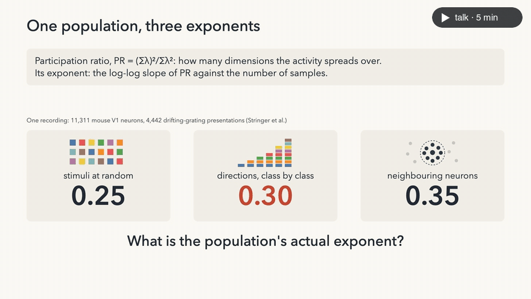
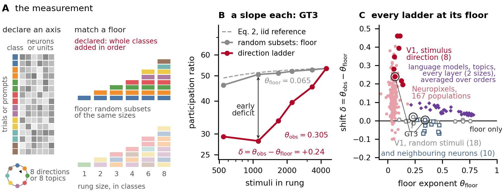
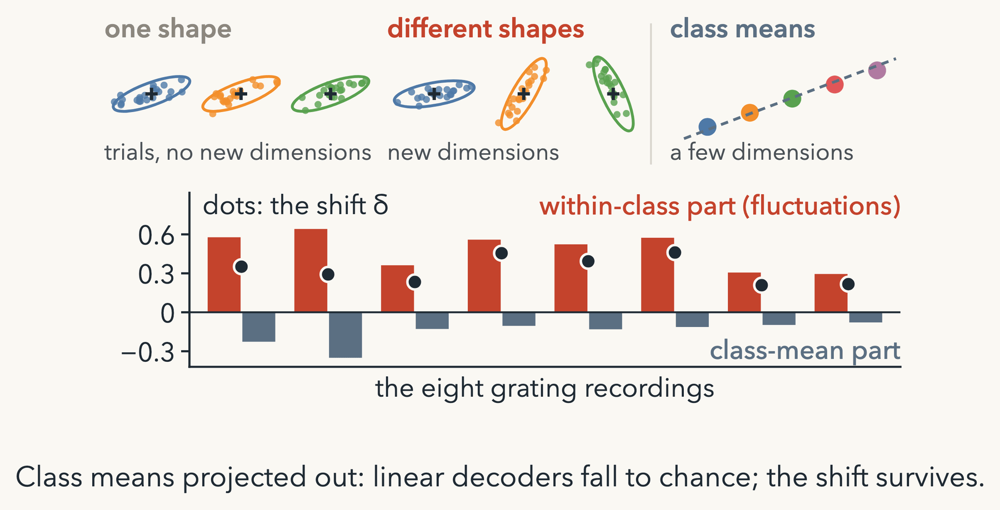
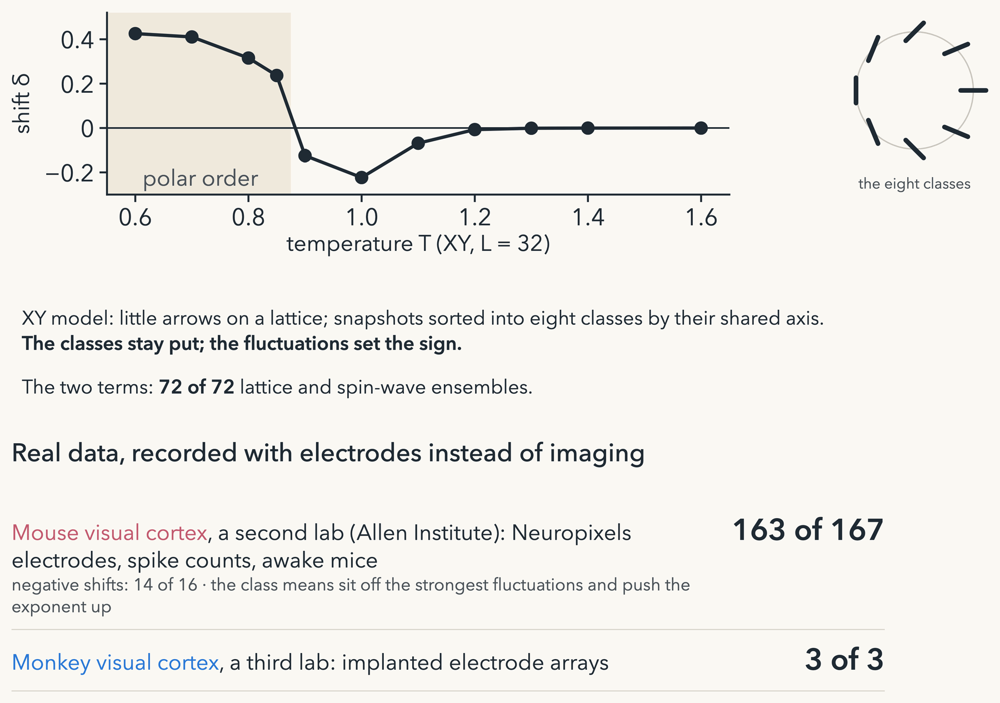
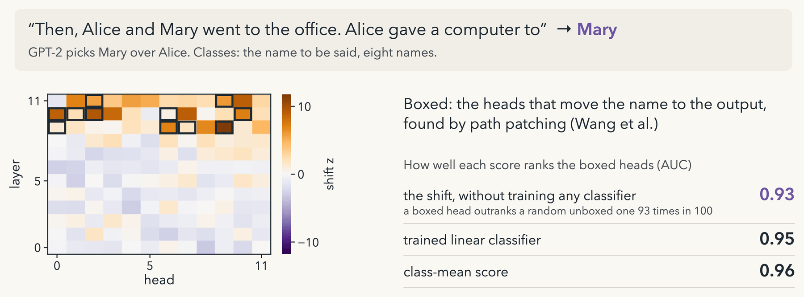
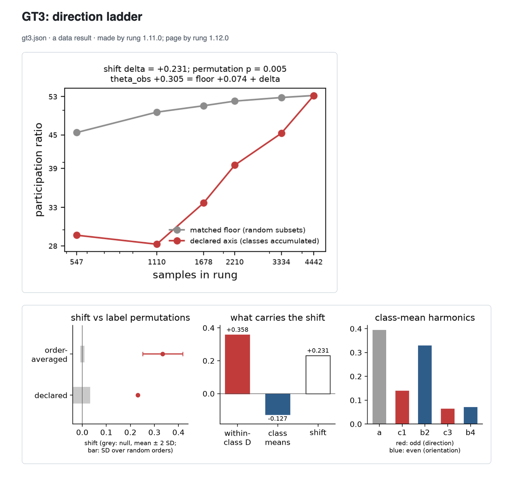

# Structure is in the zoom

**A dimensionality exponent measures the population and the probe together.** Code and data for *Structure is in the zoom:
probing neural symmetry through dimensionality scaling*, by Adil Amin (ZEHEN Labs), NeurReps 2026 (Proceedings of Machine Learning
Research), and `rung`, the tool that splits an exponent into the part sampling gives and the part a label adds.

[](https://youtu.be/S4kUtP37KLM)
[](https://colab.research.google.com/github/adilamin89/structure-in-the-zoom/blob/main/examples/quickstart.ipynb)
[](https://github.com/adilamin89/structure-in-the-zoom/tags)
[](https://github.com/adilamin89/structure-in-the-zoom/blob/main/LICENSE)

## One recording, three exponents

You count how many dimensions a population's activity spreads over, its participation ratio, on bigger and bigger subsets, and
report the log-log slope as the population's exponent. One recording of 11,311 mouse V1 neurons gives three. Add stimuli at random
and the slope is 0.25. Add the drift directions class by class, 0.30. Add neurons instead of stimuli, the nearest neighbours of one cell first, 0.35.
Which one is the population's?

Each number mixes the population with how it was sampled. Split it into a **floor**, what random subsets of the same sizes give
with the labels ignored, and a **shift**, what the path adds. The random-stimulus and neighbouring-neuron exponents are almost all
floor. Direction lifts the exponent above its floor in every grating recording; to three places, its 0.305 is a floor of 0.065
plus a shift of 0.240. Same population, three paths: the structure is in the zoom.

That lift lives in trial-to-trial fluctuations that differ between directions; the class means, which linear decoders read, pull
the other way. Two measured quantities account for the shift: how much the classes' fluctuations overlap, and how the means sit
against them. They give its sign even where it turns negative, in an XY spin lattice as it warms, in a second laboratory's mouse
recordings and in macaque V1. In GPT-2 the same measurement ranks the circuit heads that path patching found.

There is no probe-free dimensionality exponent. Even random sampling is a probe; it gives you the floor. Report an exponent with
its path, its floor and its shift. `rung` reports all three for any labelled recording or language-model layer.

<a href="https://youtu.be/S4kUtP37KLM"></a>

<p align="center"><sub>From the talk, silent, with the ladder drawn from the paper's data. <a href="https://youtu.be/S4kUtP37KLM">Watch the five minutes with sound</a>.</sub></p>

## What the paper finds

### Every ladder has a floor; direction alone leaves it



<sub>Figure 1 of the paper. (A) A declared axis adds whole classes in order; its floor draws random subsets of the same sizes.
(B) The recording above: the floor (grey) and the direction ladder (red), whose slopes split as θ<sub>obs</sub> =
θ<sub>floor</sub> + δ. (C) Every ladder's shift against its floor. On the zero line an exponent is all floor; above it,
directions lift all eight grating recordings and 158 of 167 Neuropixels populations (temporal frequencies pooled), and topics
every layer of Pythia-160m and 2.8B (averaged over class orders).</sub>

Random-stimulus exponents from 0.11 to 0.75 track their floors in all 18 imaging recordings: move the subset sizes and the same
population returns another exponent.

### Fluctuations carry the lift; class means pull it down



Clouds of one shape add trials and no new dimensions. Clouds stretched different ways each add dimensions the others held weakly,
so the direction ladder climbs faster than its floor, while the class means stack variance onto a few strong ones. The split is
exact: the within-class part runs +0.29 to +0.64 across the eight grating recordings, the class-mean part -0.08 to -0.35. Remove
the class means from every trial and linear decoders fall to chance, while the shift still clears its permutation test in every
half of every recording.

### Two measured terms give the sign where it changes



Class means along the strongest fluctuations stack variance onto them and lower the exponent; means along weak ones fill those
dimensions and raise it. In the XY lattice the classes lie on the same orbit at every temperature and the fluctuations decide the
sign: the two terms give it in all 72 lattice and spin-wave ensembles. In Allen's recordings the class means sit off the largest
fluctuations, which are partly the animal's state, and raise the exponent. With each direction's temporal-frequency tuning
removed, the shift is negative in 16 of the 167 populations; the two terms, computed at the rungs' own sample counts, get 163 of
the 167 signs and 14 of those 16, where always guessing positive gets 151.

### The same zoom inside a language model



Prompts are the samples, each attention head's write the features, the name to be said the label. With no classifier trained,
the shift's z ranks the eleven name-mover and backup heads at AUC 0.93 (the mean of ten seeds), beside 0.95 for a trained linear
classifier and 0.96 for the heads' class-mean variance share, also classifier-free. The score measures how strongly the label
organizes what each head writes; finding the heads the output relies on takes an intervention. In four Pythia models a topic
axis lifts every layer, more so late.

## Try it

```bash
pip install "git+https://github.com/adilamin89/structure-in-the-zoom@v1.12.0"
rung data X.npy labels.npy --decompose --out r.json    # X: samples by features; one label per row
rung summarize r.json                                  # the reading; rung report r.json writes a page
```

On the [quickstart notebook](https://github.com/adilamin89/structure-in-the-zoom/blob/main/examples/quickstart.ipynb)'s toy,
eight classes that differ only in their fluctuations, the reading opens:

```text
theta_obs = +0.511 = floor +0.271 + shift +0.240 ...
declared order: z = +20.2, two-sided Monte Carlo p = 0.002 ...
split (Section 5): within-class part D +0.212 + class-mean part (Tb + Cb + Cx) +0.028 ...
```

From Python: `from rung import zoom, decompose`. Appendix M's command on the paper's recording, 4,442 presentations by 11,311
neurons, takes 48 s of one laptop core in rung 1.11 and later (33 minutes in 1.10); [REFERENCE.md](https://github.com/adilamin89/structure-in-the-zoom/blob/main/REFERENCE.md#worked-examples)
works it through from the public download, and a language model the same way.

<details>
<summary>What <code>rung report</code> writes</summary>



One page per result: the ladder against its floor, the shift against its permutations, what carries it, the class-mean harmonics
and the reading. Here the paper's recording runs through `rung` with its default floor of 20 random ladders, shift +0.231. A shift
moves with its floor's random draws: the paper prints this ladder's shift at +0.231 to +0.240 under different draws (+0.240 in
Figure 1), all within 1.5 standard deviations of the mean over 20 seeds of the default floor, +0.234 ± 0.004; `--paper-floor`
replays Table 9's +0.233
([PAPER.md](https://github.com/adilamin89/structure-in-the-zoom/blob/main/PAPER.md#rung-against-the-paper)).

</details>

## What rung reads

| To find out | Run |
|---|---|
| how much of an exponent is floor, and how much a label adds | `rung data X.npy y.npy` |
| what carries the shift: the fluctuations or the class means | `--decompose` |
| the class means alone, or the fluctuations with the means removed | `--arm between`, `--arm within` |
| whether the two measured terms account for the shift | `--account` |
| which of several labels organizes a population | `--candidates` (`--halves`: pick on one half, check on the other) |
| the shift with a nuisance, acquisition blocks or time order held fixed | `--strata`, `--time-blocks`, `--null-shift` |
| what a ladder over neurons or features keeps | `rung features` |
| the shift at every layer of a Hugging Face model | `rung llm` (`--match-last-token` for the final-token control) |
| which attention heads, SAE latents or other units a label organizes | `rung llm --heads`, `rung heads` |
| spike counts, labels and times from an NWB file | `rung nwb` |
| the reading in plain words, and one HTML page | `rung summarize`, `rung report` |

## Reading the numbers

`rung summarize` applies the rules that bear on each result and says so in plain words: when to read the order-averaged shift,
when a class is sampled too thinly for the split, when the linear and z-scored readings disagree. The full list is here for when
you quote a shift.

<details>
<summary>The fourteen rules</summary>

1. **Declare before you look.** Classes, class count and accumulation order are fixed first.
2. **Six or more classes, ten or more samples per rung.** A two-class ladder fits a slope through two points.
3. **For unordered classes, read the order-averaged shift**, and for ordered ones too when the declared shift lies within two SDs
   over random orders of zero or more than two from their average: the declared-order value is a property of one path, and
   `rung summarize` says when.
4. **Pass your nuisance structure as strata.** A shift that survives the within-stratum permutation is the label's; one the
   stratified null absorbs is composition.
5. **Read the spectrum first**, and standardize when one direction dominates.
6. **Compare subsets at matched size only.** The shift depends on the number of features.
7. **Read D and the class-mean part** wherever the within-class scale changes with the class: the raw pooling and trace terms
   each carry that scale, with opposite signs.
8. **Sample each class well before reading the split.** In the paper's grating recordings the within-class part turned positive
   only once each class held 0.46 to 1.2 times its own fluctuation dimension in samples. The floor's first rungs estimate the pooled
   fluctuations, of dimension about m PR_class with m = K/[1+(K-1)σ] (σ the classes' mean fluctuation overlap), from as many
   samples as a declared rung spends on one class, so `D` sits below its population value, by about (m-1) PR_class/(n ln K) at n
   samples per class (an endpoint, first-order estimate), while the class-mean terms (`Tb + Cb + Cx`) move the other way.
   Evaluated at each rung's sample counts (`scripts_canonical/finite_n_identity.py`, `--account`), the identity puts the within-class
   part of eight equal Gaussian classes of PR_class = 30 within 0.05 of the population identity's value on the same rungs once a
   class holds about 20, 8 and 3 times PR_class samples at σ = 0.2, 0.44 and 0.7, at higher ratios n/PR_class for classes of
   lower PR. `--decompose` prints each class's own fluctuation dimension beside PR(W), which pools the classes.
9. **For a depth profile, the inference is on the profile**, the integrated excess of the shift over its embedding value against the
   permutation null; per-layer counts are descriptive.
10. **Report a model's shift in both frames.** Where the linear and the z-scored readings disagree in sign, or only one separates
    from its null, the linear one can follow a few high-variance units.
11. **The shift reads how classes spread.** Classes that differ only by one small offset between near-identical items give it
    nothing to read, while a linear probe can still find that offset.
12. **Any covariance statistic inherits a floor.** Read a principal-angle or other covariance comparison against its label-blind
    floor (`--cov-floors`) before comparing it across designs.
13. **Quote a shift with the floor's standard error.** Two runs with independent floors of the same draw count differ with an SD of
    about 1.4 times it.
14. **A head's z says where the axis organizes writes, not where the answer comes from.** It is a signed significance against its
    own null, not an effect size, and the net of a within-class and a class-mean part: a small but consistent write can rank high,
    a large one whose parts cancel can sit near zero, and a head the answer depends on can sit below zero. Reading the two parts
    separately does not change that: each is a slope of log PR, while reliance follows the variance a read-out uses. When an answer
    runs through a linear read-out of the class means, the class-mean share and a probe screen for reliance more directly (on the
    paper's GPT-2 circuit the class-mean share ranked the patched heads at 0.96, z at 0.92 in that run, 0.93 over ten seeds); head scores print that share's own
    permutation z beside z (the between arm, `--arm`), and an intervention decides.

</details>

## More

- [REFERENCE.md](https://github.com/adilamin89/structure-in-the-zoom/blob/main/REFERENCE.md): every command and option, what it
  returns and what the paper found with it; worked examples; speed, the permutation budget and the replays of the paper's runs.
- [PAPER.md](https://github.com/adilamin89/structure-in-the-zoom/blob/main/PAPER.md): the paper's numbers, `rung` run against
  them, runs on data the paper never saw, the public raw data, and a claim-by-claim table of artifacts and the scripts that
  write them.
- [The talk](https://youtu.be/S4kUtP37KLM) and the [quickstart notebook](https://github.com/adilamin89/structure-in-the-zoom/blob/main/examples/quickstart.ipynb).

<details>
<summary>Repository layout</summary>

```
rung.py                  the instrument: zoom(), decompose(), account(), candidates(),
                         feature_ladder(), blocks(), sectors(), cov_floors(), llm_battery(),
                         head_scores(), build_axis(), nwb_counts(), report(), and the rung
                         command line (data | features | nwb | llm | heads | axis | plot |
                         summarize | report); numpy core, torch and transformers for models
theta_zoom.py            alias of rung (the name through 1.1.0)
REFERENCE.md             every command and option, worked examples, speed and replays
PAPER.md                 the paper's numbers, their artifacts and the scripts that write them
tests/                   pytest suite: the decomposition identity, the nulls, the share of the
                         climb left after half the circle, the split at matched size, the
                         sector fit, the declared orders, the validity mask, the floor law,
                         the account, the candidate screen, the feature ladder, the blocks,
                         the loaders, the command line, and every number README.md,
                         REFERENCE.md and PAPER.md print; regressions against the paper's
                         artifacts with RUNG_DATA_TESTS=1 (raw data under raw/)
render_all.py            prints the paper's tables and headline numbers from the artifacts
axes/                    every prompt in the paper, with strata sidecars; PROVENANCE.md gives
                         origin and license per file
scripts_canonical/       one script per analysis, named for what it computes; each docstring
                         names the artifact it writes; make_fig_*.py regenerate the figures
                         from the artifacts
data_canonical/          the result files behind every reported number
figures_canonical/       the figures (drawn with matplotlib 3.10; later releases render text a
                         few pixels differently)
media/                   this page's pictures: frames of the talk and Figure 1 of the paper
examples/                the quickstart notebook
pyproject.toml           pip install -e . gives the rung command (and theta-zoom as an alias)
```

</details>

## Citation

```bibtex
@inproceedings{amin2026zoom,
  author    = {Amin, Adil},
  title     = {Structure is in the zoom: probing neural symmetry through
               dimensionality scaling},
  booktitle = {Proceedings of the NeurReps Workshop (Symmetry and Geometry in Neural Representations)},
  series    = {Proceedings of Machine Learning Research},
  year      = {2026},
  note      = {Code and data: https://github.com/adilamin89/structure-in-the-zoom}
}
```

## License

Code: MIT (see `LICENSE`). Result artifacts in `data_canonical/` may be reused with attribution to the paper. Prompts and stimuli
carry their own terms: the three axes composed for the paper are CC BY 4.0; the benchmark-derived axes and stored stimuli inherit
their sources' licenses (TruthfulQA Apache-2.0, HellaSwag MIT, ARC CC BY-SA 4.0, ETHICS MIT, BLiMP CC BY 4.0, Baroni et al. per
their release). Origins, authorship and licenses are listed item by item in `axes/PROVENANCE.md`.
