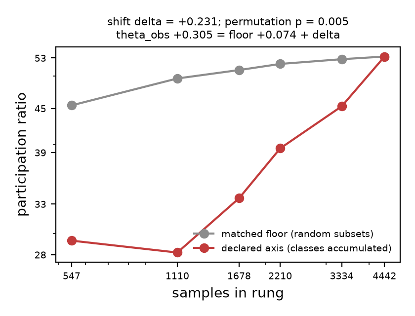
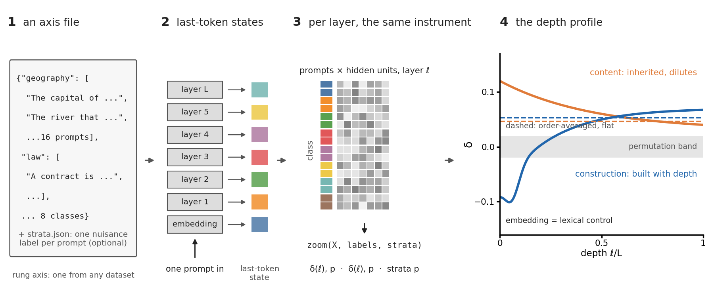

# rung reference

Every command and option of `rung`, what it returns and what the paper found with it, the worked examples, and the notes on speed and replays. The front page is [README.md](https://github.com/adilamin89/structure-in-the-zoom/blob/main/README.md); the paper's numbers are in [PAPER.md](https://github.com/adilamin89/structure-in-the-zoom/blob/main/PAPER.md).

## What rung tells you

For a samples-by-features array with one label per row (trials by neurons, prompts by hidden units, images by channels), and for
every layer of a language model at any training checkpoint, with no probe or model trained:

- **how much of an exponent is floor**, and the shift a declared label adds to it, against label permutations and nulls that keep
  a nuisance, an acquisition block or the labels' time order fixed (`theta_obs = theta_floor + delta`, exact whenever the declared
  ladder and its floor share rung sizes);
- **what carries the shift**: fluctuations that differ between classes, or the class means, with the sign law that says which way
  the class means push;
- **whether two measured terms account for it**, nothing fitted, and whether each class is sampled well enough to read it;
- **which of several candidate labels organizes a population**, discovered on one half of the data and replicated on the other;
- **what other samplings keep**: neighbouring neurons, features in a given order, blocks of features pooled by a score;
- **for a language model**, how much a declared label (a topic, a construction) adds to each layer's exponent, how much of that is
  the final token, and which attention heads' writes the label organizes.

A decoder tells whether a label can be read out; the shift tells how much of a reported exponent the label accounts for and what
sets that share. The grouping of samples into classes carries the shift. How much the order in which the classes enter moves it
depends on the design: little in the paper's grating recordings, more than the shift itself where classes differ in their own
fluctuation dimension and hold few samples (the Allen two-photon runs in [PAPER.md](https://github.com/adilamin89/structure-in-the-zoom/blob/main/PAPER.md)). `rung` reports the order-averaged shift and its SD over
orders beside the declared one, and `rung summarize` says which to read (rule 3).

## Install and run

```bash
pip install git+https://github.com/adilamin89/structure-in-the-zoom   # numpy, scipy, matplotlib
# X.npy: any samples-by-features array; labels.npy: one label per row (integers, or words, coded in sorted order)
rung data X.npy labels.npy --decompose --out r.json --plot r.png
rung summarize r.json                                                  # the reading, in plain language
rung report r.json                                                     # r.html: figure, reading, numbers
```

[examples/quickstart.ipynb](https://github.com/adilamin89/structure-in-the-zoom/blob/main/examples/quickstart.ipynb) runs the toy below and holds the commands for a recording and a language
model; it renders on GitHub and opens in Jupyter, VS Code or Colab (the badge above).

The same from Python:

```python
import numpy as np
from rung import zoom, decompose, summarize_data

X, labels = np.load("X.npy"), np.load("labels.npy")
r = zoom(X, labels, workers=0)           # floor, shift, permutation p, order-averaged shift
r["decompose"] = decompose(X, labels, workers=0)    # within-class and class-mean parts
summarize_data(r)                        # the plain-language reading
```

No data at hand? A toy population in which each of eight classes triples the variance of its own four features, so the classes
differ in their fluctuations and not in their means:

```bash
python - <<'EOF'
import numpy as np
rng = np.random.default_rng(0)
X = rng.standard_normal((512, 64))                     # 8 classes x 64 samples, 64 features
y = np.repeat(np.arange(8), 64)
X *= 1 + 2 * (y[:, None] == np.arange(64)[None, :] // 4)   # class c triples features 4c to 4c + 3
np.save("X.npy", X); np.save("labels.npy", y)
EOF
rung data X.npy labels.npy --decompose --out toy.json --plot toy.png && rung summarize toy.json
```

The shift comes out positive and above every label permutation, and the split puts nearly all of it in the within-class part,
as built: the classes differ only in their fluctuations.

**Speed and the permutation budget.** The defaults (500 label permutations, 50 random class orders, 20 floor draws) hold at
recording scale. Every ladder that accumulates whole classes and every floor draw comes from products with the Gram matrix, and
the split's traces from the same matrix (`--arithmetic fast`, the default), on threads (`--workers`): Appendix M's GT3 command,
200 permutations on 4,442 samples by 11,311 features, takes 48 s of one laptop core's time in 1.11, against 33 minutes in 1.10
measured the same way (CPU time), and returns the same numbers to 5e-15 with the same permutation p. `--paper-floor`,
`--floor-by-rung` and `--paper-seeds` keep the row-by-row arithmetic of the paper's runs, which replays their printed values bit
for bit and takes the old time. A permutation p cannot fall below 1/(n_perm + 1): with fewer than 20 permutations no shift can
reach p < 0.05, and `rung summarize` calls such a reading unresolved, never unseparated.

For a language model, clone the repository (the paper's prompt axes are in `axes/`) and add the model extras:

```bash
git clone https://github.com/adilamin89/structure-in-the-zoom && cd structure-in-the-zoom
pip install -e ".[models]"                       # + torch, transformers, datasets
rung llm --model EleutherAI/pythia-160m --axis axes/world_knowledge32.json \
         --match-last-token --out lm.json
rung plot lm.json --out lm.png && rung summarize lm.json
```

`--match-last-token` adds, at every layer, the final-token control; read a lift as more than its final tokens only with it. The
run takes 47 s of one laptop core's time in 1.11, model encoding included (16 minutes in 1.10); with `--paper-seeds`, which
replays the paper's cells in their row-by-row arithmetic, about 11 minutes.

`pip install -e ".[nwb]"` adds h5py for NWB and MATLAB v7.3 files; `".[scripts]"` adds what the analysis scripts need (h5py,
numba, scikit-learn). `rung --version` prints the release; every option's default is in `rung <command> --help`.

When the data leave a statistic undefined (fewer than three classes, no variance, classes with no within-class variance, as at a
token every prompt of a class shares), the run still finishes: that part of the result reads `undefined` (or `degenerate`) with
its reason and no number, and `rung summarize` and `rung report` say so. Invalid input (a missing file, NaN, labels of the wrong
length) stops with one `rung: error:` line.

## Worked examples

**A recording.** GT3, 4,442 drifting-grating presentations by 11,311 neurons, eight direction classes in angular order. The session
is `gratings_drifting_GT3_2019_04_05_1.npy` in the Figshare release 8279387 (Stringer et al. 2021; 489 MB), a dict with `sresp`
(neurons by presentations) and `istim` (the drift direction in radians):

```bash
curl -L -o gratings_drifting_GT3_2019_04_05_1.npy https://ndownloader.figshare.com/files/15479240
python - <<'EOF'
import numpy as np
d = np.load("gratings_drifting_GT3_2019_04_05_1.npy", allow_pickle=True).item()
np.save("gt3_X.npy", np.asarray(d["sresp"], np.float32).T)       # presentations by neurons
phi = np.asarray(d["istim"], float) % (2 * np.pi)                # drift direction in radians
np.save("gt3_labels.npy", np.clip(np.digitize(phi, np.linspace(0, 2 * np.pi, 9)) - 1, 0, 7))
EOF
rung data gt3_X.npy gt3_labels.npy --sectors --decompose --n-perm 200 --out gt3.json --plot gt3.png
```

The Python step writes presentations by neurons and eight 45-degree direction classes, the input of Appendix M's worked example.



The ladder starts low (one class spans few directions) and climbs faster than its floor as each class brings new directions. The
run prints the floor and the shift with its permutation p, the floor's own standard error, the split into the within-class part
D (+0.358) and the class-mean part Tb + Cb + Cx (-0.127), the sign law and the class-mean harmonics. `--account` adds the
two-term account, Figure 3 for this one recording.

**A model.** An axis is a JSON file `{"class": ["prompt", ...], ...}`. `--paper-seeds` reproduces the paper's per-layer cells.

```bash
rung llm --model EleutherAI/pythia-160m --axis axes/world_knowledge32.json \
         --paper-seeds --match-last-token --out lm.json
```



Declared topics lift every layer, more with depth; `--match-last-token` adds, at every layer, subsamples matched on the number of
distinct final tokens per class and size-matched random subsamples, so the lexical part of a lift is the drop from the second to
the first. For checkpoints add `--revision step1000`; for a site other than the residual stream, collect one feature vector per
prompt at that site (an MLP's neurons, a sparse autoencoder's latents) and call `zoom(X, labels)` on it.

**Attention heads.** `rung llm --heads` scores every head's write at the final token along the axis:

```bash
rung llm --model openai-community/gpt2 --axis axes/ioi_names.json --heads --paper-seeds \
         --heads-known 9.6,9.9,10.0,10.10,10.6,10.2,10.1,11.2,9.7,9.0,11.9 --out heads.json
```

On GPT-2 small's indirect-object circuit (eight indirect-object names, 16 prompts each), the heads' permutation z ranks the eleven
name-mover and backup heads that path patching found at AUC 0.92 and their class-mean variance share at 0.96, with nothing trained
(a trained linear classifier: 0.95). The split says whether a head scores through its class means or its fluctuations. A head's z reads how
strongly the label organizes its write (expression), not whether the model's answer depends on that head (reliance); z is the net
of the within-class and class-mean parts, which can cancel, and `rung report` lists both for the top heads. On the indirect-object
circuit the top heads are the path-patched ones; on another task they need not be. To find the heads the output uses, run an
intervention (patching or ablation); among rung's outputs the class-mean share tracks that best, and it is a mean screen. With `--heads-known`, every AUC prints beside the AUCs of random head sets of
the same size (for 11 of 144 heads their SD is about 0.09) with a one-sided p, each known head's rank, and the AUC of the mean
write norm, the trivial baseline (later layers write larger). `--untrained SEED` scores the same architecture with random
weights, the comparator any 'with nothing trained' claim needs; `rung report` shows both runs' AUCs side by side (`--baseline`).
`rung heads H.npy labels.npy` scores any stack of units the same way: SAE latents grouped by head, writes cached from a model
`--heads` does not know.

## Feature reference

Each entry: what it returns, the question it answers, one command, and what the paper found with it.

**`rung data X labels`**: the floor `theta_floor` and its standard error, the shift `delta`, the order-averaged shift, each against
label permutations. Before comparing an exponent across conditions, recordings or models: how much of it is floor.
`rung data X.npy labels.npy --plot r.png`. GT3's three exponents: two are floors (Section 3).

**`--decompose`** (`decompose`): the within-class part D and the class-mean part Tb + Cb + Cx, which sum to the shift; the sign law
(Eq. 3: the full-set class-mean remainder c, negative exactly when PR(W)/PR(B) exceeds 1 + 2(1 - a)/beta, a the means' alignment
with the fluctuations); `--n-bias` the finite-sample bias null. What carries a lift. In imaging the within-class part is +0.29 to
+0.64 and the class-mean part -0.08 to -0.35 (Section 5).

**`--arm between|within|both`** (`classmean_share`, `within_arm`): the paper's two arms, which separate what the classes' means
carry from what their fluctuations carry. `between`: the class means alone, their share of the variance (Tr B / Tr C), with z, a
one-sided p and the excess over the null's mean. `within`: the shift with the class means removed,
the paper's mean-free design (Appendix K, 'Class means removed'): the rows split without the labels (`--arm-halves oddeven|time|file`), on each half every
row projected off the span of that half's class means, against nulls unrestricted and inside `--time-blocks`, with the within-class
part before and after removal; `--decoder` adds a held-out decoder after removal
(the span fitted on each training fold; needs scikit-learn), since the offset a removal leaves can stay decodable. A lift the within
arm keeps is fluctuation structure that differs between classes; one only the between arm reads is the class means. With the class
means removed the eight imaging recordings keep a positive shift on all 32 label-blind halves, +0.04 to +0.51, above both
permutation nulls in every half (data_canonical/meanfree_shift_exact.json, Appendix K's design). Each arm's null keeps what its
claim leaves free (`--arm-null`, 1.13): the between arm claims only that the means differ, so its default null is a wild bootstrap
that flips the signs of each class's own residuals and keeps every class's fluctuations; the within arm claims that the
fluctuations differ with the means set aside, so its default is Freedman-Lane, the half's fitted class means plus its residuals
permuted across rows, run through the whole observed procedure. Label permutations (`--arm-null permutation`, and what
`--paper-floor` replays) make the classes exchangeable, which is more than either claim: on synthetic populations they ran liberal
for the between arm whenever the classes' fluctuations differed and liberal for the within arm under heavy-tailed gains, while the
two defaults held their level (`scripts_canonical/null_calibration.py`, data_canonical/null_calibration.json). Under Freedman-Lane, unrestricted and inside 48-presentation epochs, the mean-free shift clears both nulls at p <= 0.05 in 31 of
the 32 halves (50 draws each; `scripts_canonical/meanfree_freedman_lane.py`); the one that does not, the first time half of
low-contrast GT1, holds the smallest shift of the 32, +0.039, at p = 3/51 unrestricted and 9/51 inside epochs. Head scores print both
rankings (z and the class-mean share's permutation z); `bias_null(mode="meanfree")` is the equal-means surrogate.

**`--account`** (`account`): the measured within-class part beside the mean-field overlap law ln[K/(1+(K-1) sigma)]/ln K (sigma from
split halves) and the identity at the rungs' sample counts; the class-mean part beside Eq. 3 carried through the rungs; their sum
beside the shift; the two corrections beyond mean field; a held-out arm. Whether two measured terms give the shift, and whether the
classes are sampled enough to read it. In imaging the terms track the shift's size across the eight recordings (r = 0.88,
Figure 3); all eight shifts are positive there, so the sign is tested where it changes (Allen, macaque and the lattices; PAPER.md). For Allen's populations,
whose responses are first residualized on temporal frequency, `allen_finite_n_identity.py` evaluates the identity through that
linear step; `--account` evaluates it for the array as given.

**`--candidates L1.npy L2.npy ...`** (`candidates`): each candidate label's shift against its own permutations, inside the joint cells
of the other candidates with `--candidate-strata others`, ranked by z; `--halves oddeven` discovers on one half and replicates on
the other. Which label organizes a population. Screening four labels picks direction on 16 Allen mice and again on the other 16
(Section 8, Appendix H).

**`rung features X`** (`feature_ladder`): a ladder over features, the nearest neighbours of random anchors (`--positions`) or features
in a given order (`--order`, `--score`), against random features, with the exchangeable control. Whether anatomy or a feature
ranking concentrates dimensions. `rung features X.npy --positions cells.npy`. Neighbouring neurons sit just below their floor
(mean -0.033, negative in 8 of 10 recordings; Appendix D).

**`--block-by phase1|phase2|random|score.npy --block-size 1,4,16,32`** (`blocks`): the shift on blocks of features pooled by a score
(preferred direction, preferred orientation, a file) and on random blocks, each against its own floor. What a coarser recording
keeps. Direction-sorted blocks keep GT3's shift at every block size, random blocks lose it (+0.027 at 32; Appendix G).

**`--sectors`** (`sectors`): the harmonics of the class-mean kernel on a cyclic axis, its even (orientation) and odd (direction)
amplitudes. Which tuning the shift reads (Section 4).

**`--split-by score.npy`** (`split_by`): the top, bottom and a random third of the features at matched size, each against its own
floor. Whether a feature property carries the shift; the most direction-selective third shifts more in all eight recordings (Section 4).

**`--order sequential|antipodal|<list>`, `--antipode pairs.json`**: a declared accumulation order and, with antipodal pairs, the share of the climb left after half the circle. Order
effects and what sets them (Appendix E).

**`--strata`, `--time-blocks E`, `--null-shift`**: nulls that keep a nuisance, an acquisition block or the labels' time order fixed.
Whether a shift is the label or its composition or drift (Appendices I and K).

**`--valid mask.npy`, `--sample-times`, `--invalid-intervals`**: samples a data release marks invalid, dropped before every statistic
(Allen's invalid intervals, Section 6).

**`--cov-floors`** (`cov_floors`): the principal-angle dissimilarity between classes against its label-blind floor, predicted from the
pooled spectrum. A median 69% of that dissimilarity across 167 Allen populations is floor (Section 8, Appendix H).

**`--standardize`**: every feature z-scored first, the repair when one direction dominates the spectrum; `rung data` always prints the
z-scored shift beside the linear one.

**`--paper-floor`**, `--floor-draws`, `--floor-seed`, `--floor-by-rung`, `--rungs`: the floor's draws and the ladder's rungs.
`--paper-floor` draws the floor as the paper's imaging, Allen and macaque generators do and replays their printed values.

**`--workers N`, `--arithmetic auto|fast|rows`** (`workers=`, `fast=` in Python): how a run spends its time, never what it
returns. `--workers` runs the ladders, the floors and the split's traces on N threads (default 0: every core but one, at most eight, past
which one run gains little; Python's default is 1); every random draw is made first, in the order a serial run makes it, so any N returns the same numbers bit for
bit. `fast` computes every ladder that accumulates whole classes (the declared one, each random order, each permuted labelling)
from class-block sums of the Gram matrix and the floor's full-set rung once, and agrees with `rows`, every ladder row by row, to
about 1e-12 with the same permutation p. `auto` picks `rows` under `--paper-floor`, `--floor-by-rung` and `--paper-seeds`, so the
paper's replays stay exact, and `fast` otherwise; the result records which (`arithmetic`).

**`rung llm`** (`--revision`, `--match-last-token`, `--frames`, `--heads`, `--untrained`): every layer's shift in the linear and the
z-scored frame at any checkpoint or with random weights, the final-token report and control; every attention head with `--heads`. Topics lift every layer of four Pythia
models, and the late lift survives final-token matching (Appendix I).

**`rung axis`, `rung summarize`, `rung plot`, `rung report`**: an axis JSON from a Hugging Face dataset (it reports texts cut at
`--max-chars`, which can make the final token follow the class); a plain-language reading of any result; the figure for any result;
one self-contained HTML page for any result (the figure, the reading, the numbers a reader quotes with their settings and, for
`rung data`, the shift against its nulls, its split and the harmonics), to share or archive beside the JSON.

**Loaders**: `.npy`, `.npz:key`, `.mat:variable`, `.csv`, text; `--transpose` when X is stored features by samples.
`rung nwb session.nwb --intervals trials --label direction --out s` writes trials-by-units spike counts, labels and each row's time
window from an NWB 2 file (h5py); `--units-where location=VISp` keeps one area. NWB 1 files (Allen Visual Coding two-photon) read
with h5py directly.
